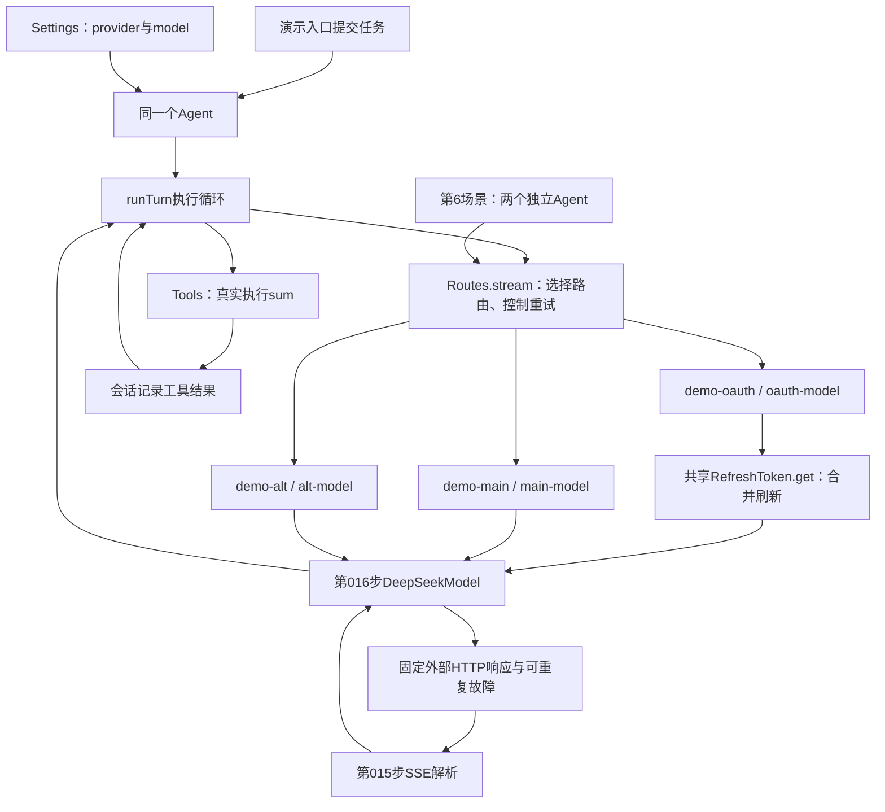
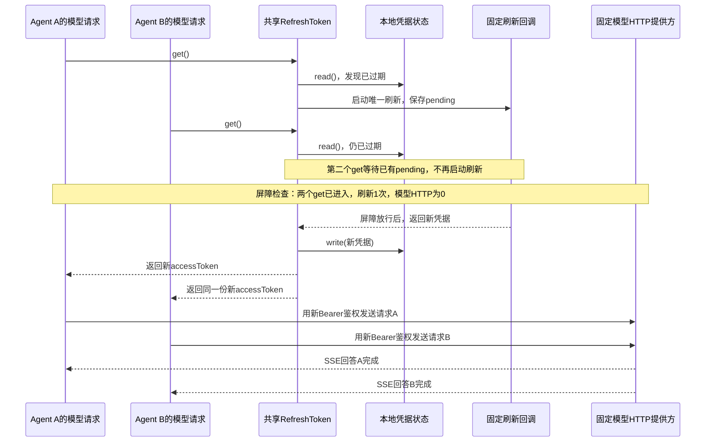

## 先把018装进一个能直接运行的应用

本步新增`src/routes-demo.mjs`，保留原来的`src/demo.mjs`。按下文创建本步文件后，在自己的PROJECT终端执行：

```sh
bun src/routes-demo.mjs
```

**不用选择模式，一次按顺序跑完六个场景。**它不读取真实模型Key，不发送收费请求。外部模型响应、故障和凭据刷新结果使用本地样本；Agent、Routes、RefreshToken、DeepSeekModel、SSE解析器、配置快照和sum工具都使用前面已经写好的真实实现。第6场景把刷新真正接到模型请求鉴权之前。

### 真正接起来的位置



入口里的关键装配就是：

```javascript
// 注册两个提供方及它们允许使用的模型名，撤销函数归scope管理。
scope.own(routes.add('demo-main', ['main-model'], main))
scope.own(routes.add('demo-alt', ['alt-model'], alternate))

// Agent拿到Routes；Loop调用同样的stream接口，具体模型由Routes选择。
const agent = new Agent(session, routes, tools, settings)
```

这里的main和alternate都是`DeepSeekModel`实例，分别装入固定的fetcher。它们会真实构造Chat Completions请求、解析返回的Response和SSE，而不是绕过适配器直接产出“成功”。

### 六个场景分别证明什么

| 顺序 | 具体发生什么 | 应当观察到什么 |
| --- | --- | --- |
| 1 | 主路由第一次HTTP调用在任何Part产出前抛错；Routes重试，同一次模型请求随后返回sum调用；工具计算出5，再发下一次模型请求 | 主路由HTTP #1失败，#2返回工具调用，#3返回最终5；sum只执行1次，turn以completed结束 |
| 2 | 同一个Agent空闲后，Settings改成demo-alt/alt-model，再提交下一轮 | 只有备用路由HTTP #1被调用，正文来自备用路由；这一轮主路由增加0次 |
| 3 | 配置改回主路由，服务端先返回“已经输出的半句”，随后没有finish_reason和[DONE]就结束响应 | 只有主路由HTTP #4；半句保存为interrupted，turn以error结束；不重试，也不自动调用备用路由 |
| 4 | 选择已注册提供方中的missing-model | 直接报“未知模型路由”；HTTP调用增加0次，没有换成默认模型 |
| 5 | 主路由连续两次在任何Part产出前失败 | HTTP #5、#6各失败一次，随后turn以error结束；没有第7次无限重试，也不自动换提供方 |
| 6 | 两个独立会话的Agent同时请求demo-oauth，共用已过期凭据；鉴权型提供方先调用token.get，再用返回值创建DeepSeekModel | 两次get只触发1次刷新、1次保存；刷新等待期间模型HTTP为0；保存后才发出2次模型HTTP，请求头都使用新凭据，两个turn均completed |

**第3～5场景的error是演示故意制造的预期失败。**程序会从实际会话事件、HTTP计数及鉴权头检查结果中核对行为，六个场景均符合预期才打印“验收结果”并正常退出；不是把error当成成功回答。第6场景包含两个并发turn，不是把两条输入塞到同一个Agent后假称并发。

第1个场景还会检查第二次模型请求的历史：其中必须包含assistant的reasoning_content、sum工具调用，以及真实计算得到的`role: tool`结果5。少了这些关联，就算终端打印5，演示也会因断言失败而非零退出。

### 逻辑请求和HTTP尝试不是一个数量

```text
一轮用户任务：计算2加3
  逻辑请求A（step 0）
    HTTP #1：尚无任何Part，抛错
    HTTP #2：同一个request重试，返回sum调用
  真实执行sum → 结果5写入会话
  逻辑请求B（step 1）
    HTTP #3：带着调用及结果继续，返回最终答案5
  turn/end：completed
```

因此第1个场景应有**2条request/start、3次HTTP尝试、1次工具执行**。Routes在一次`stream(request)`内部重试，不会因此再创建一个用户turn或再写一条request/start。当前Routes也没有为每次HTTP尝试追加独立的持久attempt事件；演示的HTTP编号只是可见计数。

### 为什么首片后不再试

Routes把提供方产出的**任何Part**都视为published，不只是文字：usage、thinking、tool等也算。如果已经把一部分结果交给Loop，再从头请求一遍，可能造成重复文字或重复调用意图，所以当前策略直接交回错误。

反过来，“还没产出Part”不代表服务器一定没收到请求，只表示Harness还没有向Loop交付结果。当前实现只做有限重试，没有精细区分401、网络故障等错误是否值得重试，也不能据此承诺外部操作恰好执行一次。它不会自动切换提供方。

### 用具体失败场景理解published

**published不是“回复完成了”，也不是“已经显示正文了”。它记录的是：本次尝试有没有向Loop交付过任何Part。**每次重试开始都会重新设为false；只要进入一次`yield part`，就先设为true。

#### 场景一：用户让模型计算2加3，网络在首个Part之前失败

```text
用户提交“计算2加3”
→ 请求模型，尚未向Loop交付任何Part
→ 网络报错
→ published=false，attempt=0，用户也没取消
→ Routes允许再尝试一次
→ 重试成功，模型提出sum调用，Loop执行工具
```

此时Harness尚未交付正文或调用意图，所以当前策略允许有限重试。这对应demo第1场景；不是重新提交一轮用户任务，也不会因为这次网络重试就执行两遍sum。

#### 场景二：用户已经看到半句回答，随后断流

```text
模型返回正文“已经输出的半句”
→ DeepSeekModel产出text Part
→ Routes先设published=true，再交给Loop
→ Loop记录stream/text，展示端可以显示这半句
→ 响应缺少完整结束信息就断了
→ Routes直接抛错，不再从头请求一遍
```

如果自动重试，新请求可能再次生成同一句，或生成另一份不同答案，无法直接接到旧半句后面。当前Loop把已收到的非空正文保存为`interrupted: true`，turn以error结束。这对应demo第3场景。

#### 场景三：只收到usage，还没有任何正文，随后失败

假设服务端先返回用量`{ "prompt_tokens": 100, "completion_tokens": 0 }`，之后响应中断，没有正文、没有工具调用，也没有完整结束信息：

```text
DeepSeekModel产出usage Part
→ Routes把published设为true
→ Loop记录request/usage
→ 后续解析发现模型消息未完整结束，抛错
→ published=true，所以当前代码不重试
```

**即使用户屏幕上一个字都没出现，当前代码仍然会禁止重试。**这是因为它把usage和正文一概视为“已交付Part”，不代表usage本身一定不能重试，也不代表工具已经执行。

这里是当前实现偏保守的地方。如果后续要允许“只交付usage后失败”重试，需要分开管理两件事：哪些内容已经交付、是否可以重试，以及每次attempt的用量。比如第一次尝试收到usage后失败、第二次成功，两次用量应能分别追踪，不能悄悄丢掉第一次，也不能把不同尝试的用量误记成一次成功请求；同一次尝试的多个用量快照如何汇总，还要看提供方语义。**这些是改进方向，本步没有据此修改重试规则。**

#### 场景四：还没有结果，但用户主动取消

```text
模型请求还在等待，published=false
→ 用户取消当前任务，signal.aborted=true
→ 请求因取消而抛错
→ Routes不重试，Loop将turn记为cancelled
```

用户已经要求停止，即使没有交付任何Part，也不能自动再发一次请求。这里阻止重试的是signal，而不是published。

#### 场景五：连续两次都在首个Part之前失败

```text
第1次：attempt=0，published=false → 失败后允许再试一次
第2次：attempt=1，published=false → 失败后直接抛错
```

这里阻止第3次请求的是`attempt >= 1`。即使一直没有结果，也不能无限请求。这对应demo第5场景。

| 失败前发生了什么 | published | 其他条件 | 当前是否重试 |
| --- | --- | --- | --- |
| 首次尝试还没交付任何Part | false | 未取消、attempt=0 | 允许再试一次 |
| 已交付正文片段 | true | 即使attempt=0 | 不重试，保留中断正文 |
| 只交付了usage | true | 即使没有正文或工具调用 | 不重试，属于当前保守策略 |
| 用户取消，还没有交付Part | false | signal.aborted=true | 不重试 |
| 第二次尝试仍没有交付Part | false | attempt=1 | 不再重试 |

表中前两类及次数上限已有对应demo；usage和取消在这里补充的是规则说明，没有新增demo场景。调试时在Routes的catch分支观察`published、request.signal.aborted、attempt`，就能指出究竟是哪一个条件阻止了重试。

最后注意：**网络收到SSE事件，不等于Routes已经向Loop交付Part。**例如第016步会暂存thinking和工具参数，完整校验后才产出相应Part；因此不能仅凭“服务端已经返回thinking字段”就断定published已经为true。判断依据是提供方的`stream()`是否已经实际yield出Part。

### RefreshToken真正接在模型鉴权前

前5个场景保留固定演示Key；第6个场景另注册鉴权型提供方`demo-oauth`。两个独立Agent共享同一个Routes，并最终进入同一个RefreshToken实例。下面摘出该提供方的关键顺序，完整代码中的计数和屏障在此省略：

```javascript
// 每次模型请求先拿到有效凭据，不能复用创建提供方时已经过期的key。
const accessToken = await token.get()
request.signal.throwIfAborted()

// 只给这次请求创建模型实例，不通过修改共享model.key来传递凭据。
const model = new DeepSeekModel({
  baseURL: 'https://oauth-model.invalid',
  model: 'oauth-model',
  key: accessToken,
  fetcher
})
yield* model.stream(request)
```

`DeepSeekModel.stream()`随后才构造`Authorization: Bearer ...`。所以不是调用一次get做个演示，却仍拿固定Key发请求；模型实例实际使用的key就是这次get返回的值。



#### 把gate理解成一道手动放行的闸门

**这里的“屏障”就是一个还没完成的Promise：某段代码await它，就先停在那里；另一段代码调用release，才允许它继续。**暂停的是等待它的异步函数，其他请求和协调代码仍然可以运行，不是把整个JavaScript线程堵住。

为什么要故意暂停？我们要验证的是“刷新还没完成时，另一个请求也来取凭据，两者共用这次刷新”。如果刷新太快，实际可能是：

```text
A取凭据 → 刷新已经完成 → B才来取凭据
```

这种情况虽然也只刷新一次，但没有验证两个请求重叠时的合并。因此demo先让刷新停在闸门前，等两个请求都到达，再放行。

`gate()`的实现很短：

```javascript
// 创建一道一次性闸门，返回“等它打开”和“打开它”两个入口。
function gate() {
  // 保存Promise的完成函数，交给协调代码在条件满足后调用。
  let release
  const promise = new Promise(resolve => { release = resolve })
  return { promise, release }
}
```

`await 某个gate.promise`表示等待通知；`某个gate.release()`表示发出通知。如果先release、后await，后来的等待者也能直接通过。这不是一扇会自动关回去的门：同一个gate只完成一次，重复release没有额外效果。

#### 三个gate分别由谁通知、由谁等待

| 名字 | 白话含义 | 谁调用release | 谁等待promise |
| --- | --- | --- | --- |
| `arrivals` | “两个模型请求都已调用token.get了” | 提供方入口看到`stats.getCalls === 2`时 | 负责验收和放行刷新的协调代码 |
| `started` | “刷新回调确实启动了” | 刷新回调在`stats.refreshes++`后 | 同一段协调代码 |
| `finishRefresh` | “现在允许刷新完成” | 协调代码确认前两个通知到齐、计数正确后 | 刷新回调中的`await finishRefresh.promise` |

前两个主要是**报到通知**；第三个才是**人为延迟刷新完成的闸门**。`arrivals`打开不表示已经拿到新token，`started`打开也不表示刷新已经完成。

三个通知配合起来是下面这个过程。为方便说明，把先到的请求叫A；程序不依赖A、B标签的先后顺序：

```text
A调用token.get
  → 发现凭据过期，创建共享刷新任务this.pending
  → 刷新回调启动，started.release()：“我开始刷新了”
  → 刷新回调await finishRefresh.promise，暂不返回新凭据

B也调用token.get
  → 到达计数变成2，arrivals.release()：“两个请求都到了”
  → RefreshToken发现已有this.pending，等待已有刷新

协调代码等到arrivals和started两个通知
  → 检查getCalls=2、refreshes=1、modelHTTP=0、pending存在
  → finishRefresh.release()：“现在可以完成刷新了”

刷新回调返回新凭据 → write保存
  → A、B各自的token.get返回新凭据
  → A、B分别构造模型鉴权头并发送请求
```

`arrivals`和`started`可以按任意顺序打开，协调代码用`Promise.all`等它们都完成，而不是猜谁会先到。源码外层的`Promise.race`还检查“两位Agent是否已经提前结束”：若它们没走到预期等待点就都结束了，立即报错；它不是让A、B争抢刷新资格。

所以不能把这段改成`sleep(100)`来理解：“等100毫秒”只说明时间过去了，不保证另一个请求已经进入get，也不保证刷新真的启动。当前gate等的是明确发生的事情，能够稳定复现并发重叠。刷新完成后A、B谁先发送HTTP不作要求。

#### gate和RefreshToken.pending的区别

| 对象 | 管什么 | 在本例里存什么 |
| --- | --- | --- |
| 三个gate | 控制demo的复现时机，让协调代码知道何时检查、何时放行 | “到齐了”“启动了”“允许完成”的一次性通知 |
| `RefreshToken`的`this.pending` | 真正合并并发刷新，保证后来者等待已有刷新任务 | 刷新、保存、返回新accessToken这一整段工作的Promise |
| 提供方里的`const pending = token.get()` | 当前这一次调用等待有效凭据 | 此次get返回的Promise，不是共享实例上的那个属性 |

**只保留gate、去掉this.pending的合并，两个请求仍可能各刷新一次；保留this.pending、去掉demo的gate，实际刷新仍能合并，只是本地演示不能保证每次都碰到重叠时机。**生产中的慢速刷新接口会自然产生等待，本例用gate人为制造这段等待。

另外，get是async方法，不要通过比较两次`token.get()`返回的Promise对象是否`===`来验证合并。关键是内部有没有复用同一个刷新任务，以及最终是否只刷新、保存一次、两个请求都拿到新凭据。

`finally`中再次调用`finishRefresh.release()`也是为了收尾：即使某个验收断言失败，也先打开demo自己关住的闸门，再关闭Agent；否则Agent可能一直等着被人为暂停的刷新。重复release不会再刷新一次，刷新次数由this.pending及刷新回调决定。

**为什么是两个Agent？**第013步的同一Agent会串行执行turn。同一个Agent先后submit两条任务，只会让第二条等待第一条，无法证明刷新期间的并发合并；本场景使用两个会话、两个Agent，只有鉴权管理器和Routes共用。

模型fetcher会读取两个实际请求的Authorization头，比较它们是否使用刷新后的凭据、发送前新凭据是否已经保存。摘要只保存`usedNewToken`、`savedBeforeSend`两个布尔值，不保存或打印token。真实OAuth登录、授权码换票、远端刷新端点和磁盘凭据加密仍未接入；这里验证的是刷新管理器已经进入真实的模型鉴权调用链，刷新服务的响应由本地回调固定提供。

### 运行后怎样验收

先按下文创建文件，再在自己的PROJECT终端运行：

```sh
bun src/routes-demo.mjs
bun test ./tests/018-routes-demo.test.mjs
bun test ./tests/018-routes.test.mjs
bun test
```

终端输出应能顺序对上上表。最后一行以`018验收结果：`开头，包含从实际运行计算的JSON摘要：

- 六个场景reason依次是`completed、completed、error、error、error、completed`；第6场景内部两个turn都应completed。
- 原前5场景计数保持`mainHTTP: 6`、`altHTTP: 1`、`toolRuns: 1`、`replayChecked: true`。
- `oauth.beforeRelease`应为`getCalls: 2、refreshes: 1、modelHTTP: 0、pending: true`，证明不是先把一个请求做完再运行另一个。
- 第6场景最终`oauth.refreshes: 1、writes: 1、modelHTTP: 2`；A、B请求的`usedNewToken`和`savedBeforeSend`均为true，正文分别为A完成、B完成。
- `oauth.pendingCleared`为true，两个并发Agent均关闭、监听归零、临时鉴权路由撤销。
- 清理结果为`agentClosed: true`，routes、tools、listeners均为0。

新增测试会真正启动`bun src/routes-demo.mjs`这个CLI子进程并检查这些结果；直接运行入口也会执行同样的应用流程。不要把六个场景的输出替换成手工打印的预期字符串。

第6场景还应该看到以下日志；A、B发送及完成的相对顺序可以不同，但都必须发生在新凭据保存后：

```text
[凭据刷新] 开始刷新；先等待两个模型请求都进入token.get()
[刷新等待点] 两个get已进入、刷新1次、模型HTTP仍为0；现在放行刷新
[凭据保存] 新凭据已保存，不输出凭据值
[鉴权请求 A] 使用新token=true，保存完成后发送=true
[鉴权请求 B] 使用新token=true，保存完成后发送=true
[并发Agent A] turn/end=completed
[并发Agent B] turn/end=completed
```

### 用VS Code附加到实际demo，而不是只调独立测试

在自己的PROJECT的`.vscode/launch.json`中，将下面这个对象加到现有`configurations`数组里，保留之前的配置：

```json
{
  "name": "Bun：018路由演示（附加）",
  "type": "bun",
  "request": "attach",
  "url": "ws://127.0.0.1:6499/routes-018"
}
```

打开`src/routes-demo.mjs`和`src/routes.mjs`，先设置断点，再在PROJECT集成终端运行：

```sh
bun --inspect-brk=127.0.0.1:6499/routes-018 src/routes-demo.mjs
```

进入“运行和调试”，选择“Bun：018路由演示（附加）”，按F5连接，再按F5继续到断点。终端等待连接是正常行为。

| 断点位置 | 观察什么 |
| --- | --- |
| demo中`new Agent(session, routes, tools, settings)` | 传给Agent的model是routes，而不是某一个DeepSeekModel |
| routes中`this.providers.get(request.config.provider)` | 第一轮选择demo-main/main-model；第二轮选择demo-alt/alt-model，配置在turn边界取得快照 |
| routes中`if (published ... ) throw error` | 第1次失败attempt=0、published=false，允许重试；第3场景published=true，不重试；第5场景第二次失败attempt=1，停止重试 |
| demo中main fetcher的`stats.mainHTTP++` | 每进入一次才是真正的一次HTTP尝试，和Loop的request/start数量分开数 |
| demo中sum的run函数 | 只在第1场景命中一次，检查参数a=2、b=3，工具返回5 |
| demo中refreshScene的`const pending = token.get()`，以及routes.mjs中RefreshToken.get的`this.pending ??=` | 第一个请求创建pending，第二个请求复用已有pending；不要在调试控制台额外调用get，以免改变计数 |
| demo中`stats.beforeRelease = ...` | 两个get已经进入，refreshes=1、modelHTTP=0，token.pending存在；尚未发送带过期凭据的模型请求 |
| demo中的`const accessToken = await pending`之后和`new DeepSeekModel(...)` | 两个请求都在刷新保存完成后继续；只观察writes计数与流程，不把凭据值复制到日志或笔记 |
| demo中鉴权fetcher的`const usedNewToken = ...`之后 | A、B的usedNewToken和savedBeforeSend都为true；不要打印整个options.headers |

原有“Bun：当前测试”仍可调`tests/018-routes.test.mjs`中的Routes分支。新增CLI集成测试会另开子进程，若要逐步观察demo本身，就使用上面的attach方法，不要以为父测试停住就已经附加到子进程。

先不看结果表，自己预测每一轮会增加几次HTTP调用，再实际运行对照。合上材料讲清“第1轮为什么3次HTTP却只执行1次工具”和“第6场景为什么两个get只刷新一次”。次日只重做仍讲不清的那一处。临时把RefreshToken中的`this.pending ??=`改成`this.pending =`，预测第6场景的刷新次数，运行后应因重复刷新导致验收失败；恢复原代码并重跑。不要改掉计数断言让错误实现通过。
