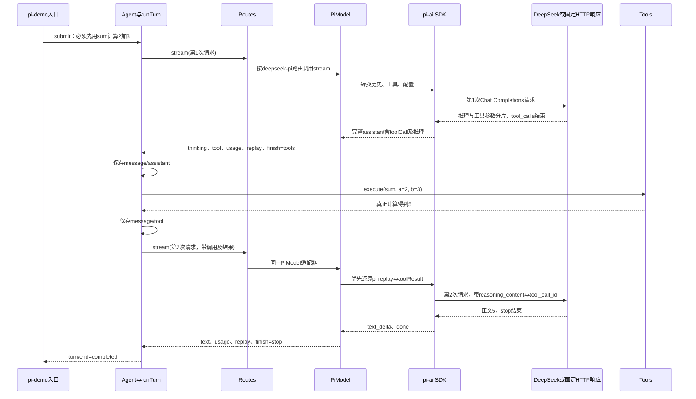

## 先讲清楚：这里想替换什么，DeepSeek还在不在

**这里想替换的是“访问模型服务的代码”，模型服务本身可以仍然是DeepSeek。**DeepSeek和pi-ai不在同一层：

| 名字 | 在这一层负责什么 |
| --- | --- |
| DeepSeek | 远端模型服务，收到请求后生成推理、正文和工具调用 |
| 第016步的DeepSeekModel | 我们自己写的访问适配器：构造HTTP请求、解析SSE、拼接工具参数，再产出Harness的Part |
| pi-ai | 访问模型服务的SDK，让SDK承担请求和协议解析工作 |
| 本步的PiModel | 我们自己写的转换层：把Harness历史转成SDK输入，再把SDK事件转回Part |

对照两条调用链看，替换位置在Loop下面：

```text
016的方式：
Loop → DeepSeekModel → 自己发HTTP、解析SSE、拼接工具参数 → DeepSeek

020新增的可替换实现：
Loop → PiModel → pi-ai负责HTTP和协议解析 → 模型服务（可以仍然配置DeepSeek）
```

本步新增`src/pi-demo.mjs`，把第二条调用链真正接进Routes和Agent，远端仍配置为DeepSeek。**换SDK不等于换模型，接入SDK也不等于整个Harness交给SDK管理。**Loop、Tools、权限、配置快照和会话事实仍由我们的代码负责。

### 为什么用了SDK，还要写PiModel

因为Loop只认识我们定义的`stream(request)`和Part，不认识pi-ai的事件名、工具结果类型和模型上下文结构。PiModel主要做两次转换：

```text
请求方向：
Harness历史、工具、配置 → PiModel.context() → pi-ai需要的上下文

响应方向：
pi-ai的text_delta / done等事件 → PiModel.stream() → text / tool / usage / replay / finish等Part
```

例如SDK返回`text_delta`，本步转成`{ kind: 'text', text: ... }`；SDK完整回复中的toolCall转成`kind: 'tool'`。完整assistant消息保存到`replay`，后续请求优先还原它，减少丢失SDK或提供方专有字段的风险。

因此，调用Loop的一方可以选择把DeepSeekModel或PiModel交进去，Loop继续使用同一个Part接口。这是接口可以替换的原因，而不是因为两者内部代码相同。

## 本步实际接线：Routes里注册PiModel

本步新增`src/pi-demo.mjs`，保留之前的演示文件。入口使用同一套Agent、Routes、Tools、Settings和Events；远端配置保持DeepSeek，访问实现改为PiModel加固定版本`@earendil-works/pi-ai@1.1.0`。

```javascript
// model.provider仍是deepseek，api选择OpenAI兼容Chat Completions入口。
const adapter = new PiModel(model, key, fetcher)

// deepseek-pi是我们注册表里的路由名，用来说明采用哪种访问实现。
scope.own(routes.add('deepseek-pi', [modelId], adapter))

// settings中provider=deepseek-pi，Agent仍拿Routes，不直接绕过路由找模型。
const agent = new Agent(session, routes, tools, settings)
```

两个provider名字不要混淆：Settings中的`deepseek-pi`用于查自己的Routes；SDK模型配置中的`provider: 'deepseek'`说明远端模型属于DeepSeek。`api: 'openai-completions'`说明使用兼容协议，不代表调用OpenAI公司的模型。默认目标是`deepseek-flash`与`https://api.deepseek.com/chat/completions`。[DeepSeek官方调用方式](https://api-docs.deepseek.com/zh-cn/)

### 同一条任务怎样完成模型→工具→模型



模型只提出调用意图，真正相加的是本机Tools中的sum函数。第二次请求的HTTP观察点会检查：assistant调用和tool结果使用相同ID、工具结果确实是`{ ok: true, value: 5 }`、reasoning_content正确回传。终端打印5但没走这些步骤，demo仍会验收失败。[DeepSeek工具续轮示例](https://api-docs.deepseek.com/zh-cn/guides/tool_calls/)

## 按顺序运行：先确定性验收，再真实调用DeepSeek

先按下文在自己的PROJECT创建本步文件，沿用第016步的`.env.example`；在PROJECT终端安装本步锁定依赖：

```sh
cp "$COURSE/locks/020.bun.lock" bun.lock
bun install --frozen-lockfile --ignore-scripts
bun src/pi-demo.mjs
bun test ./tests/020-pi-demo.test.mjs
bun test ./tests/020-pi.test.mjs
bun test
```

无参数运行固定HTTP响应，不读真实Key、不发网络请求，但真实使用pi-ai SDK解析SSE和拼接工具参数，真实执行Routes、Agent和sum。它没有直接调用第016步的DeepSeekModel。原有适配器测试保留，新集成测试实际启动同一个CLI入口。

离线验收日志应依次包含：

```text
[请求] deepseek-pi/deepseek-flash step=0
[HTTP #1] deepseek-flash /chat/completions，携带工具结果=false
[工具开始] sum
[工具结果] {"ok":true,"value":5}
[请求] deepseek-pi/deepseek-flash step=1
[HTTP #2] deepseek-flash /chat/completions，携带工具结果=true
[正文] 5
[轮次结束] completed
```

固定样本通过后，用编辑器打开自己的PROJECT/.env，沿用第016步已配置的Key，不覆盖已有凭据。如果尚未创建.env，先将.env.example复制为.env，再只在本机编辑器填写：

```dotenv
DEEPSEEK_API_KEY=
DSH_MODEL=deepseek-flash
DEEPSEEK_BASE_URL=https://api.deepseek.com
```

随后执行真实请求：

```sh
bun --env-file=.env src/pi-demo.mjs --live
```

`--live`使用同一条Agent→Routes→PiModel→pi-ai链，只将外部HTTP换成实际fetch；会消耗模型额度。缺少Key就非零退出，不会偷偷改跑离线模式。默认不传--live仍是固定样本，即使环境里已有Key也不会自动发真实请求。

演示任务固定为先调用sum计算2加3，最多放行两次HTTP请求；模型没有按预期调用工具、返回错误或超过这个演示预算，都会明确失败。这里是小范围贯通验收，不是允许任意任务的产品CLI。模型配置中的cost零系数只是SDK字段占位，不能把它当作真实费用统计。

### 两种运行都怎样算完成

最后一行以`020验收结果：`开头，由实际会话事件和HTTP观察点生成，必须满足：

- route为`deepseek-pi`，SDK provider为`deepseek`，model默认`deepseek-flash`，api为`openai-completions`。
- `requests: 2`、`http: 2`、`toolRuns: 1`、`reason: completed`、`finalText: "5"`。
- `historyChecked: true`、`reasoningReplayed: true`，两条assistant的`replayProviders`均为pi。
- `agentClosed: true`，注册路由、工具和监听均归零。
- 固定响应时mode为offline，真实请求时mode必须为live；不能拿offline记录代替真实模型证据。

本次维护者已实际使用本机既有凭据调用DeepSeek，得到两次HTTP、一次sum执行及最终5，推理和工具结果回传核对通过；摘要见[真实请求记录](../evidence/020-pi-live.json)。真实响应措辞可能不同，demo要求最终正文去掉首尾空白后是数字5。

原有`tests/020-pi.test.mjs`仍直接验证SDK适配边界；新增`tests/020-pi-demo.test.mjs`验证完整CLI链及真实模式缺Key拒绝。自动化测试只跑固定HTTP响应，不会批量调用真实API。

## VS Code：附加到020的实际demo

在自己的PROJECT/.vscode/launch.json中，把下面对象加到已有configurations数组，保留之前的配置：

```json
{
  "name": "Bun：020 pi-ai（附加）",
  "type": "bun",
  "request": "attach",
  "url": "ws://127.0.0.1:6499/pi-020"
}
```

先在PROJECT终端启动固定响应演示：

```sh
bun --inspect-brk=127.0.0.1:6499/pi-020 src/pi-demo.mjs
```

在VS Code选择“Bun：020 pi-ai（附加）”，按F5连接，再按F5继续到断点。离线链看懂后，停止本次进程，在同一终端启动真实模式，再用同一配置附加：

```sh
bun --env-file=.env --inspect-brk=127.0.0.1:6499/pi-020 src/pi-demo.mjs --live
```

| 断点位置 | 应该观察什么 |
| --- | --- |
| pi-demo中`routes.add('deepseek-pi', ...)`和`new Agent(...)` | 注册对象是PiModel，Agent拿到Routes，SDK model.provider仍是deepseek |
| routes.mjs中`this.providers.get(...)` | request.config.provider匹配deepseek-pi，不再调用DeepSeekModel |
| pi.mjs中`context(request)` | 第1次历史是用户输入；第2次多出完整SDK assistant replay和toolResult |
| pi.mjs中`if (event.type === 'done')` | 第1次是toolUse并含完整toolCall与thinking；第2次是stop |
| pi-demo中sum的run | 参数a=2、b=3，实际返回5，只执行一次 |
| pi-demo的fetcher中`if (index === 1)`之后 | 第二次请求已经通过tool_call_id、工具结果和reasoning_content校验；不要打印鉴权头或Key |

PiModel把SDK的maxRetries设为0，由Routes掌握有限重试，避免两层重试叠加。每次SDK请求有30秒超时；真实模式在长时间暂停后可能超时，先用离线模式理解流程，不删除超时或断言来通过验收。当前模型ID必须和Routes选择一致，未知或不一致配置不能悄悄改用默认模型。

## 本步边界与闭卷回忆

新demo确实将PiModel接进Routes和Agent，也实际验证了DeepSeek模型→工具→模型的续轮；旧的demo及DeepSeekModel仍保留。本步不证明所有协议、所有提供方、跨适配器旧历史迁移、完整取消矩阵和产品发布资格都已完成。固定SDK版本和当前路由的证据不能扩大成全provider等价。

先合上代码，自己画出两条调用链，说明仍用DeepSeek时替换了哪层。然后指出第二次HTTP请求的工具结果从哪来、为何必须保留replay；次日只闭卷重做这两个卡点。调试或记录时不把Key、鉴权头和实际推理正文复制进学习笔记。
