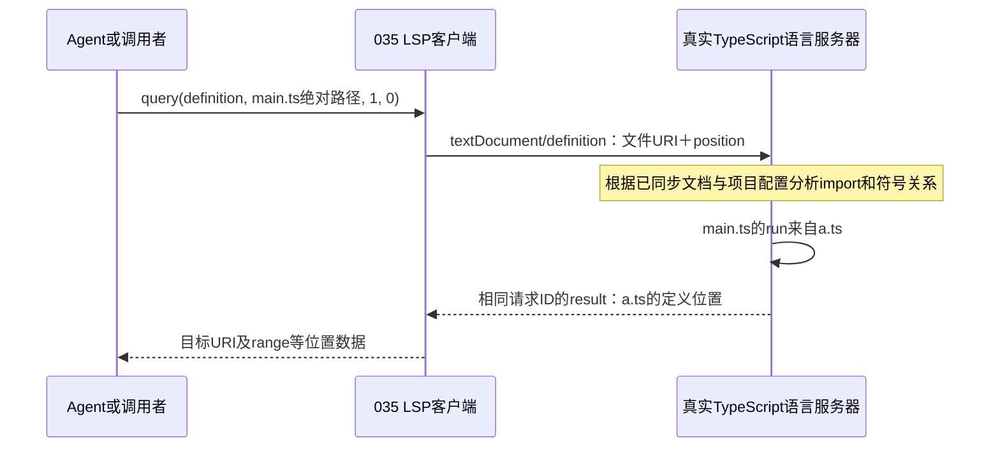
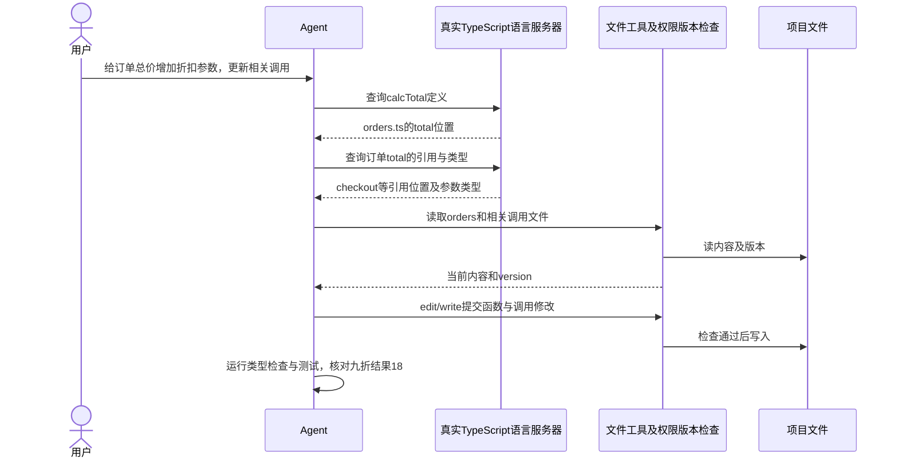

## 同名函数：文本搜索找到名字，语义导航找到关系

你准备修改一个`run()`调用，项目里却有好几个叫run的函数。文本搜索能列出候选位置，但仅凭“字符串相同”，还不知道这个调用究竟指向谁。语言服务器分析import、作用域和类型等代码关系，再回答指定位置上的符号定义在哪里；这就是语义导航，类似VS Code的F12“转到定义”。

下面是用于理解的三文件例子，不要求替换本章的固定LSP测试对端：

```ts
// /project/src/a.ts：一个run函数。
export function run() { return 'A' }
```

```ts
// /project/src/b.ts：另一个同名函数。
export function run() { return 'B' }
```

main.ts的实际两行内容如下；文件路径是`/project/src/main.ts`，不把说明性注释算进坐标：

```ts
import { run } from './a'
run()
```

| 方式 | 给它什么 | 能得到什么 |
| --- | --- | --- |
| 文本搜索 | 搜索字符串run | a.ts、b.ts的定义、main.ts的import和调用等候选匹配；还可能包含注释或普通字符串。 |
| 语义导航 | main.ts的文件标识＋第二行run上的光标位置 | 在正确配置的TypeScript语言服务里，沿import关系定位到a.ts的run定义，而不是b.ts。 |

这不是说文本搜索没用：先找关键词、文件或错误文案时，它通常更直接。需要区分同名符号、确认真实定义或引用关系时，再用语言服务器消除歧义。真实语言服务也依赖正确的项目配置、依赖和文档同步，不能只按名字猜一个结果。

### 文件URI：告诉服务端正在问哪个文件

请求不能只说“查run”，因为不同文件里相同名字的含义可能不同。LSP使用文档URI标识文件，例如：

```text
本机路径：/project/src/main.ts
文件URI：file:///project/src/main.ts
```

URI是文件地址标识，不是在发HTTP请求，也不意味着文件内容已上传。035的`document(path)`用`pathToFileURL(path).href`完成转换；`open`与`change`再发送正文和版本，使语言服务器知道当前文档内容。

```js
import { pathToFileURL } from 'node:url'

// 使用当前主机上的绝对路径，转换器会处理空格、中文和百分号等编码。
const uri = pathToFileURL('/project/src/main.ts').href
```

不要手工用`'file://' + path`拼接：文件名有特殊字符时容易产生不同的文件标识。这里的/project是解释用路径，运行实际项目时要用真实存在的工程路径。

### 行列坐标：告诉服务端正在问哪个符号

本章`lsp.query(method, path, line, character)`把坐标原样传入LSP协议，**line和character都从0开始**。上面main.ts中，第二行开头的run就是`line=1, character=0`：

```text
编辑器显示第1行：import { run } from './a'    → LSP line=0
编辑器显示第2行：run()                      → LSP line=1
                ↑
                第1列，LSP character=0
```

下面表示客户端已经连接真实语言服务，并已同步该文件内容时的查询方式；它不是现有fixture已经能分析这三个文件的证明：

```js
// 查询main.ts第二行开头run的定义，path传绝对路径。
const locations = await lsp.query('definition', '/project/src/main.ts', 1, 0)
```

035会将它编码为类似请求；示意ID用于关联回复，实际ID由Peer生成：

```json
{
  "jsonrpc": "2.0",
  "id": "definition-1",
  "method": "textDocument/definition",
  "params": {
    "textDocument": { "uri": "file:///project/src/main.ts" },
    "position": { "line": 1, "character": 0 }
  }
}
```

行列位置应落在要查询的符号上；光标指向空白或无关符号时可能返回空结果。返回位置通常包含目标文件URI与range，也可能按服务器能力使用位置数组或LocationLink；不能只假定所有服务器都返回本章fixture的单个对象形状。

### character不是UTF-8字节偏移

本章没有协商其他positionEncoding，按LSP默认的UTF-16位置解释character。这和JavaScript字符串下标一致：普通中文通常占1个单位，部分emoji占2个；不是按屏幕宽度或UTF-8字节数算。

```js
// prefix的JS长度是4：中=1、emoji=2、空格=1；其UTF-8长度则是8字节。
const prefix = '中😀 '
console.log(prefix.length) // 4
console.log(Buffer.byteLength(prefix, 'utf8')) // 8
```

如果一行注释文字是`中😀 run`，其中r的字符串下标是4，不是UTF-8字节偏移8；这只是坐标算术示例，不是说注释中的run可以跳转到函数定义。真实代码的位置要基于实际文件每一行的内容计算。

再和032区分一次：**Content-Length按UTF-8字节数分帧，position.character按协商的位置编码定位符号。** 同一条请求里的这两种长度不能互换。

原版Harness对模型公开的lsp工具使用从1开始的行列，再转换到内部从0开始的位置；035的`query`直接接协议坐标。不要把原版工具参数或VS Code显示的第2行第1列，不经转换就传成`query(..., 2, 1)`。

### 一次定义查询怎样返回



真实语言服务可能跨多个文件分析，不是本客户端自己递归搜索run字符串；035的Peer负责请求与回复关联，framing负责Content-Length字节边界，语言服务器才负责代码理解。

### 当前035测试证明到哪里

本章现有测试启动的`tests/fixtures/lsp.mjs`会固定返回定义位置，并没有TypeScript解析器。因此测试证明的是“真实子进程＋握手＋文档通知＋URI/坐标请求＋结果返回”链路，不证明上面a/b/main的语义解析已经运行。

在VS Code调本章测试时，可在`src/lsp.mjs`的`document`、`query`和`peer.request`处停下，看path怎样变URI、line/character怎样进入params；当前实际输入是example.ts及`0, 7`，不是上例的`1, 0`。fixture运行在另一个进程，父进程不会因设了服务端断点而自动附加它。原版坐标转换可对照[tool-lsp实现](../../../deepseek-harness/packages/lsp/tool-lsp/src/index.ts)。

合上说明，指出main.ts第二行run的URI、从0开始的坐标，以及根据import应返回哪个文件；再解释为什么搜索到b.ts的同名定义还不能证明它就是当前调用的定义。

## 一个修改任务：给订单总价增加折扣参数

你对Agent说：“给订单总价计算增加折扣参数，并修改相关调用处。”下面说明接入真实TypeScript语言服务后，Agent怎样利用导航信息完成工作；不是当前fixture已经运行的端到端案例，也不要求现在把这些文件加入练习工程。

```ts
// orders.ts：这次要修改的订单计算函数。
export function total(price: number, count: number) {
  return price * count
}
```

```ts
// statistics.ts：同名，但负责统计数组总和，不应因名字相同就被修改。
export function total(values: number[]) {
  return values.reduce((a, b) => a + b, 0)
}
```

```ts
// checkout.ts：导入时使用别名，实际调用名字已经不是total。
import { total as calcTotal } from './orders'
calcTotal(10, 2)
```

如果只搜索total，Agent会遇到多个同名定义；只搜索`total(`，又可能漏掉`calcTotal(10, 2)`这样的别名调用。文本搜索仍能帮助读代码，但仅凭匹配列表不能确认每个调用的符号关系。

### 语言服务能给Agent提供哪些信息

| Agent的问题 | 真实TypeScript语言服务可提供的信息 | Agent据此做什么 |
| --- | --- | --- |
| checkout里的calcTotal定义在哪？ | 沿import别名定位orders.ts的total。 | 找对要修改的函数，避免误改statistics.ts。 |
| 哪些代码引用了这个订单函数？ | 返回当前项目分析范围内的符号引用位置，包含导入别名相关引用。 | 逐个读取相关文件，检查哪些调用和测试需要一起修改。 |
| calcTotal接受什么参数，返回什么？ | 悬停类型信息，例如`(price: number, count: number) => number`。 | 理解原接口，再决定怎样增加折扣参数。 |

服务返回的是位置或类型信息，并不替Agent决定折扣业务规则。例如本例决定用0.9表示九折，需要由任务要求或Agent与用户确认的约定确定，不能从函数名字推导出来。引用结果也依赖项目配置和可分析代码范围，不代表自动找到字符串拼接、运行时注册或项目外的所有使用者。

### 谁负责实际改文件

在本例的Harness流程里，Agent拿到导航结果后，仍需使用文件工具读取目标内容、取得版本，再通过edit/write提交修改；工具入口继续负责参数、权限及文件版本检查。语言服务器提供导航和类型信息，文件工具执行磁盘修改，测试负责验证结果。

假设任务已经明确折扣系数的含义，可以把订单函数和调用调整成下面这样；statistics.ts保持原有用途：

```ts
// orders.ts：折扣系数作为新增必填参数；这是业务修改示意。
export function total(price: number, count: number, discountRate: number) {
  return price * count * discountRate
}
```

```ts
// checkout.ts：根据任务要求，为调用补上九折系数。
import { total as calcTotal } from './orders'
calcTotal(10, 2, 0.9) // 预期18。
```



图里类型检查和测试是Agent另外执行的验证步骤，不是definition请求自动完成的事；查到了引用位置，也不等于已经修改成功。035目前未注册到Agent工具表，这条完整工作流仍需真实服务、工具装配和验收。

### 当前fixture具体做不到哪些

| 当前代码 | 已做到 | 没做到 |
| --- | --- | --- |
| tests/fixtures/lsp.mjs | 独立Bun进程、initialize回复、固定definition位置、shutdown/exit。 | 没有TypeScript解析器，不分析orders/statistics/checkout，也不理解import别名。 |
| 固定definition处理函数 | 把请求里的文件URI放进回复，固定返回第0行的range。 | 不会沿calcTotal跳到orders.ts；名字、坐标变化也不会产生真实符号判断。 |
| 文档open/change链路 | 客户端发通知，并维护自己的版本Map。 | fixture没有保存和分析文档，因此不能据此证明修改后导航已使用新内容。 |
| 其他导航能力 | 客户端有通用query封装。 | fixture没有references或hover处理函数，调用会报未知方法；真实方法所需参数与能力检查也还需补齐。 |
| Agent业务接线 | 有独立协议与进程测试。 | 没有自动查询定义、遍历引用、调用edit修改、运行测试的完整任务流程。 |

因此，这个例子说明“语言服务值得接进Agent的原因”，不能作为当前035已经能完成订单重构的证据。现有测试仍只验收固定对端的通信流程，未运行上述业务修改。

合上这一节，用一句话分别回答：是谁判断calcTotal指向orders.ts，谁决定折扣含义，谁把修改写入磁盘，谁验证结果18？再指出当前fixture缺在哪一环。
