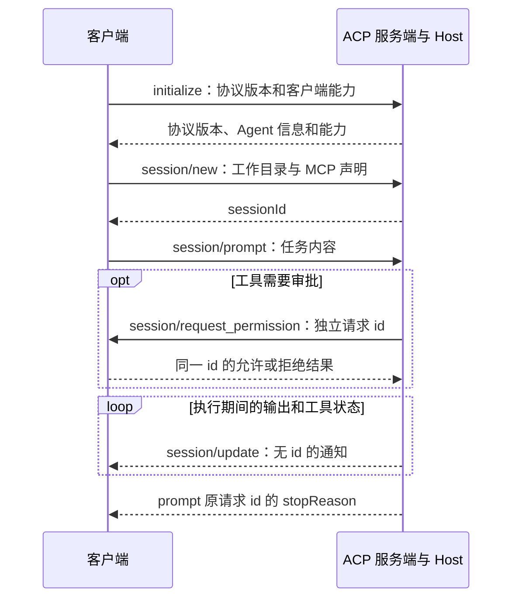

## ACP 补充问答：管道、SDK、协议和 Host 到底怎么接

这一节整理学习本章时容易混在一起的几个问题。以教程固定的 `@agentclientprotocol/sdk@1.4.0` 和本章代码为依据；该 SDK 的稳定 ACP 协议版本为 `1`，SDK 包版本与协议版本分别编号。

### 1. SDK 走 stdio，ACP 是走 HTTP 吗？

本章的两种入口都走 stdio，但使用的业务方法不同：

| 入口 | 本章传输方式 | 方法示例 |
| --- | --- | --- |
| 第 044、045 课自己写的 Bun / Python SDK | stdio，JSON-RPC 消息按行发送 | `session.create`、`session.submit`、`session.wait` |
| 第 046 课 ACP | stdio，JSON-RPC 消息按行发送 | `initialize`、`session/new`、`session/prompt` |
| 后面的 Web 入口 | HTTP / WebSocket | 由 Web 接入层定义 |

stdio 回答“消息怎么运过去”；JSON-RPC 约定请求、响应、通知的信封；ACP 再约定 Agent 操作的方法名、参数、结果和能力协商。共用 stdio 不代表两种接口可以互换。

本章能力声明中的 `mcpCapabilities: { http: true }` 表示 Agent 可以接入 HTTP 类型的 MCP 工具服务，不表示客户端通过 HTTP 连接这个 ACP 服务。原版随附 ACP 应用也使用 stdio；这里不把其他版本或其他传输实现一概归为本章实现。

### 2. `child.stdin` 和 `child.stdout` 分别往哪边走？

站在测试客户端这一侧，向 `child.stdin` 写数据，就是给子进程的 `process.stdin` 发消息；从 `child.stdout` 读数据，就是接收子进程写到 `process.stdout` 的消息。

```mermaid
flowchart LR
    subgraph Client["客户端进程：046-acp.test.mjs"]
        direction TB
        Call["client.request / client.notify"]
        Encode["ACP SDK：JSON 转字节并加换行"]
        Write["Writable.toWeb(child.stdin)"]
        Read["Readable.toWeb(child.stdout)"]
        Decode["ACP SDK：按行拆分并 JSON.parse"]
        Dispatch["匹配响应、分发通知、处理审批请求"]
        Call --> Encode --> Write
        Read --> Decode --> Dispatch
    end
    subgraph Server["Host 子进程：acp-server.mjs"]
        direction TB
        Stdin["process.stdin"]
        Parse["ACP SDK：解析消息，按 method 分发"]
        Adapter["acp.mjs：协议参数转为业务调用"]
        Host["Host / Agent / 工具"]
        Send["ACP SDK：结果或通知转为 JSON 行"]
        Stdout["process.stdout"]
        Stdin --> Parse --> Adapter --> Host
        Host --> Send --> Stdout
    end
    Write ==>|"stdin 管道：客户端到 Host"| Stdin
    Stdout ==>|"stdout 管道：Host 到客户端"| Read
```



对应代码如下，参数顺序先写后读：

```javascript
// 写端用于发送给Host；读端用于接收Host发来的消息。
const stream = acp.ndJsonStream(
  Writable.toWeb(child.stdin),
  Readable.toWeb(child.stdout),
)
```

`Writable.toWeb`、`Readable.toWeb` 只是把 Node 风格的流转换成 Web Streams 接口，不负责解释 ACP。`ndJsonStream` 才负责 JSON 与换行字节流之间的转换；具体业务发送由 `request`、`notify`、处理函数返回结果等操作触发。

这里存在两条方向相反的单向管道，合起来支持双向通信。Host 的 stdout 不只有“对请求的回复”，也会出现主动通知和向客户端发起的审批请求。stderr 是单独的诊断通道，不混入 ACP 消息。

### 3. ACP 的消息具体长什么样？

以下会话 ID 简化为 `s1`。为便于阅读，JSON 展开显示；线上发送时每条消息压成一行，并在结尾添加换行。

客户端发送请求：有 `id`、`method` 和 `params`。

```json
{
  "jsonrpc": "2.0",
  "id": 2,
  "method": "session/prompt",
  "params": {
    "sessionId": "s1",
    "prompt": [{ "type": "text", "text": "hello" }]
  }
}
```

Agent 通过通知发送执行过程：有 `method`，没有 `id`，无需逐条回复。

```json
{
  "jsonrpc": "2.0",
  "method": "session/update",
  "params": {
    "sessionId": "s1",
    "update": {
      "sessionUpdate": "agent_message_chunk",
      "content": { "type": "text", "text": "[离线演示] hello" }
    }
  }
}
```

任务结束后，Agent 使用与请求相同的 `id` 返回结果：

```json
{
  "jsonrpc": "2.0",
  "id": 2,
  "result": { "stopReason": "end_turn" }
}
```

失败时返回 `error`，不返回成功的 `result`。例如非法参数错误的信封可以是：

```json
{
  "jsonrpc": "2.0",
  "id": 2,
  "error": { "code": -32602, "message": "Invalid params" }
}
```

`id` 是某次请求的编号；`sessionId` 是业务会话身份。一段会话会有很多请求，不能拿 sessionId 代替请求匹配。客户端和 Agent 各自生成自己的请求 id，所以两个方向出现相同数字也不表示同一个请求。

`await client.request(session/prompt, ...)` 最后得到结束原因。过程中生成的文字、工具状态由 `session/update` 通知传给回调；不能只看最终的 result 寻找完整回复。

### 4. 为什么 Host 也会向客户端发请求？

ACP 是双向通信。Host 执行写文件工具时，可以通过 `session/request_permission` 询问客户端“是否允许”；客户端负责展示选择或按自己的策略回答。本章测试的客户端自动选 `allow`，不是由模型决定授权。



假设 Agent 的审批请求 id 为 `0`，客户端选中允许一次，回复内容如下：

```json
{
  "jsonrpc": "2.0",
  "id": 0,
  "result": {
    "outcome": { "outcome": "selected", "optionId": "allow" }
  }
}
```

取消任务则是客户端发送 `session/cancel` 通知，不等待这条通知的响应。原来尚未完成的 `session/prompt` 会在取消结算后返回结果；本章测试检查其 `stopReason` 为 `cancelled`。

### 5. 为什么 ACP 直接用了 SDK，看不到底层实现？

这里有两个名字都带 SDK 的组件：第 044 课的 `src/sdk.mjs` 是自己写的 Harness SDK；本章导入的 `@agentclientprotocol/sdk` 是第三方 ACP SDK。本章没有通过前者转发请求。

当前课练习“接入标准 ACP SDK，并实现自己的 Agent 侧适配”。JSON 编解码、请求编号、等待表和方法分发使用库实现，没有要求学习者在本章重新实现整套标准协议。这部分与第 032 课手写的 Peer、pending 请求表、消息分发属于同类机制；实际兼容规则以 ACP SDK 为准。

| 观察点 | 当前固定 SDK 中的阅读位置 | 观察什么 |
| --- | --- | --- |
| 创建请求 | `node_modules/@agentclientprotocol/sdk/dist/jsonrpc.js` 的 `prepareRequest` | 生成 id，登记 pendingResponses，构造消息信封 |
| 发出消息 | 同文件的 `sendWireMessage` | 按写入队列送给 stream.writable |
| 字节编码 | `node_modules/@agentclientprotocol/sdk/dist/stream.js` 的 `writeJson` | JSON.stringify、加换行、TextEncoder、写管道 |
| 接收拆包 | 同文件的 `ndJsonStream` | 累积字节、按行拆分、JSON.parse；一次读取不保证只有一条 JSON |
| 方法分发 | `jsonrpc.js` 的 `processIncomingMessage`，以及 `ConnectionBuilder.onReceiveRequest` | 找到与 method 匹配的处理函数 |
| 回到业务 | 自己的 `src/acp.mjs` 的 `session/prompt` 处理函数 | host.open、agent.submit、agent.idle |
| 响应匹配 | `jsonrpc.js` 的 `handleResponse` | 按 id 找等待者，resolve(result) 或 reject(error) |

这些依赖文件的行号可能随版本变化，按函数名定位即可。可以在本地打开依赖源码阅读、设断点；不要直接修改 node_modules 作为自己的正式实现。客户端进程的断点观察发送与接收，服务端处理函数需要在子进程调试会话里观察，具体操作见本课末尾。

### 6. `acpApp(host)` 为什么要传 Host？Host 是按 ACP 接口实现的吗？

Host 有自己的业务接口：`create`、`open`、`list`、`closeSession`。ACP 适配层负责把标准方法和参数翻译成这些调用，Host 本身无需认识 `session/prompt` 这个协议方法名。

| ACP 方法 | `acpApp` 中对应的业务动作 |
| --- | --- |
| `session/new` | `host.create(...)`，返回 ACP sessionId 与配置选项 |
| `session/prompt` | `host.open(...)`、订阅事件、`agent.submit(...)`、等待执行与通知发送，再转换 stopReason |
| `session/list` | `host.list(...)`，转换成 ACP 会话列表 |
| `session/close` | `host.closeSession(...)`，返回 ACP 结果 |

服务端代码可以拆成三步看：

```javascript
// Host持有会话、Agent和执行资源，留在当前服务端进程。
const host = new Host(process.env.HARNESS_HOME)

// 适配层注册ACP方法的处理函数；函数通过闭包访问这份Host。
const app = acpApp(host)

// 接上当前进程的stdio，让消息进入已注册的处理函数。
const stream = ndJsonStream(
  Writable.toWeb(process.stdout),
  Readable.toWeb(process.stdin),
)
const connection = app.connect(stream)
```

这里是普通的本地函数调用，没有把 host 对象传过管道。跨进程传递的是 JSON；服务端按 JSON 中的 method 调用适配函数，再访问自己进程里的 Host。

也要区分 `acpApp(host)` 与 `app.connect(stream)`：前者建立“ACP 方法对应什么业务动作”的关系，后者把已有消息流接到这组处理函数上。Host 子进程由测试中的 spawn 启动，connect 不会替你另起一个进程。

因此 Bun/Python SDK 的 remote、ACP 的 acpApp、Web 接入层都可以调用同一套 Host 实现。这不表示所有入口自动连接同一个正在运行的 Host 进程，也不表示各自的权限、能力声明和会话可见性自动相同；要看入口实际装配。

### 7. 怎样打印管道里的消息，又不破坏协议？

本章测试已提供 `traceACPStream`，开启方式是：

```sh
env -u DEEPSEEK_API_KEY ACP_TRACE=1 bun test ./tests/046-acp.test.mjs
```

它在 `ndJsonStream` 与 `app.connect` 之间包装消息流：读取方向使用 `pipeThrough(new TransformStream(...))`，打印后继续 enqueue；写入方向包装 writable.write，打印后交给原 writer。这样看到的是完整 JSON 消息，而不是可能只包含半个 JSON、半个中文字符的字节块。

日志前缀区分 `[ACP Client → Host]` 和 `[ACP Host → Client]`，使用 console.error 输出到 stderr。打印请求和响应时对照 id，打印通知时对照 method 与 sessionId。消息日志能显示“传了什么”；上一张源码表帮助继续看“内部怎么实现”。
