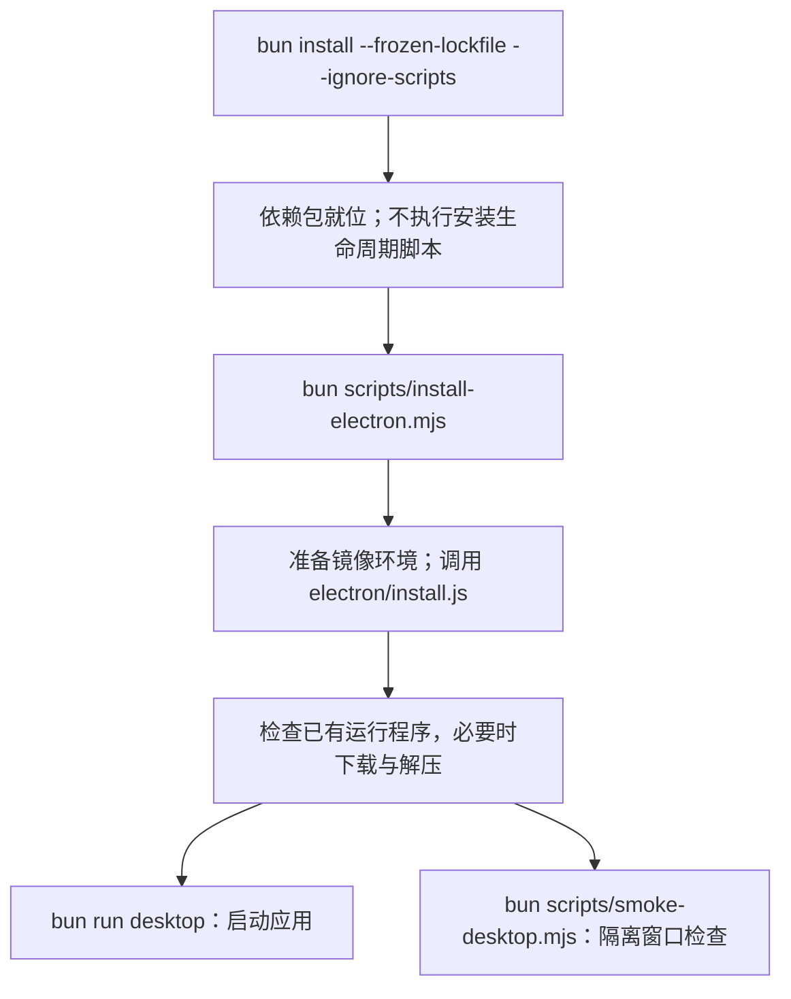

## 为什么还要运行 install-electron.mjs？

`scripts/install-electron.mjs` 是下载准备脚本；真正负责下载、缓存检查和解压的是 `node_modules/electron/install.js`。它不会安装本项目的桌面成品，也不会创建窗口。

### Electron 不是本来就有 postinstall 吗？

不能只凭包名判断。带有 `scripts.postinstall` 的 Electron 包，在包管理器允许执行安装脚本时，可以由该钩子调用安装器；使用 Bun 还要符合其依赖脚本信任配置。本教程的 `--ignore-scripts` 明确跳过生命周期脚本，因此不能依赖自动执行。

另外，本次核对项目本地 `node_modules/electron/package.json`：版本为 `44.7.0`，有 `install.js`，但没有 `scripts.postinstall` 声明。所以不能把本项目需要显式安装的原因只归结为 `--ignore-scripts`，也不能承诺删掉该参数就会自动下载。其他安装版本请以各自实际包元数据为准。

本教程显式执行安装器，把“安装 JS 依赖”和“下载平台运行程序”分开；下载失败时能单独定位和重试，不需要重装所有依赖。

### 包装脚本每一段在做什么？

| 代码位置 | 实际作用 | 为什么这样做 |
| --- | --- | --- |
| `const environment = { ...process.env }` | 复制当前环境给安装子进程 | 保留 PATH、代理和已有镜像；不修改当前进程的原始环境表 |
| `homedir()` 与 `process.cwd()` | 依次定位用户级、当前项目的 `.npmrc` | 项目配置后读，同名镜像值可覆盖用户配置；必须在 PROJECT 根目录执行 |
| `readFileSync`、逐行正则匹配 | 只提取 `electron_mirror` 或 `electron-mirror`，去掉值两端引号 | 不把整份配置或 registry token 输出到日志 |
| 捕获 `ENOENT` | 配置文件不存在就跳过 | 没有 `.npmrc` 很正常；权限等其他读取错误仍报错 |
| 两个环境变量的判断 | 已有 `ELECTRON_MIRROR` 或 `npm_config_electron_mirror` 时不覆盖；否则使用文件中提取的镜像 | 显式环境设置优先；直接运行安装器时不假定包管理器已注入 `.npmrc` 字段 |
| `spawnSync(process.execPath, ...)` | 用当前 Bun 执行 `node_modules/electron/install.js`，同步等待 | `process.execPath` 是启动本脚本的运行程序，不是固定的 Node 路径 |
| `stdio: 'inherit'` | 安装器直接使用当前终端输入、输出和错误通道 | 能直接看到下载进度和错误 |
| `timeout: 180_000` | 包装器最多等待三分钟 | 下载或安装卡住时明确失败；不是成功保证 |
| `result.error` 与 `result.status ?? 1` | 启动失败、超时则抛错；否则返回安装器退出码，缺失退出码按失败处理 | 外层命令能区分下载成功与失败 |

没有任何镜像设置时，下载地址由官方安装器决定。平台、架构、包版本、下载和解压逻辑也都由它负责，包装脚本没有重新实现这些功能。

### 普通项目一定要自己写这个包装吗？

不一定。如果实际安装的包声明了 postinstall、包管理器允许它执行、镜像设置又能正确传进去，就可以使用自动安装。本项目包装额外提供的是镜像读取、显式下载时机和三分钟等待上限。

在自己的 PROJECT 根目录，先安装依赖，再执行本课安装脚本，最后运行桌面入口。不要把 `bun test ./tests/052-desktop-policy.test.mjs` 通过当作 Electron 已下载或窗口已打开：那项测试只检查策略函数。窗口启动与烟测是另外两步。
