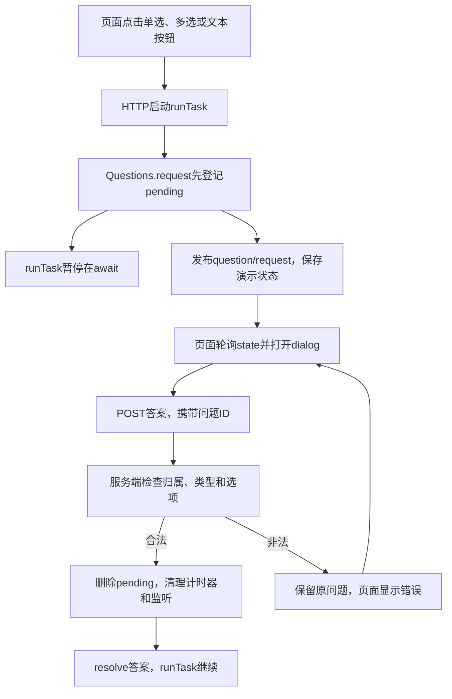
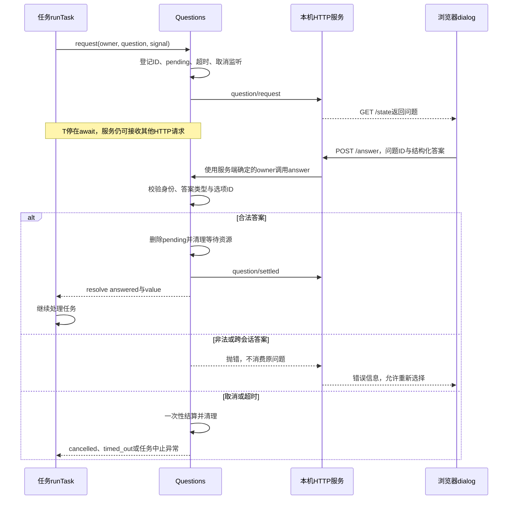
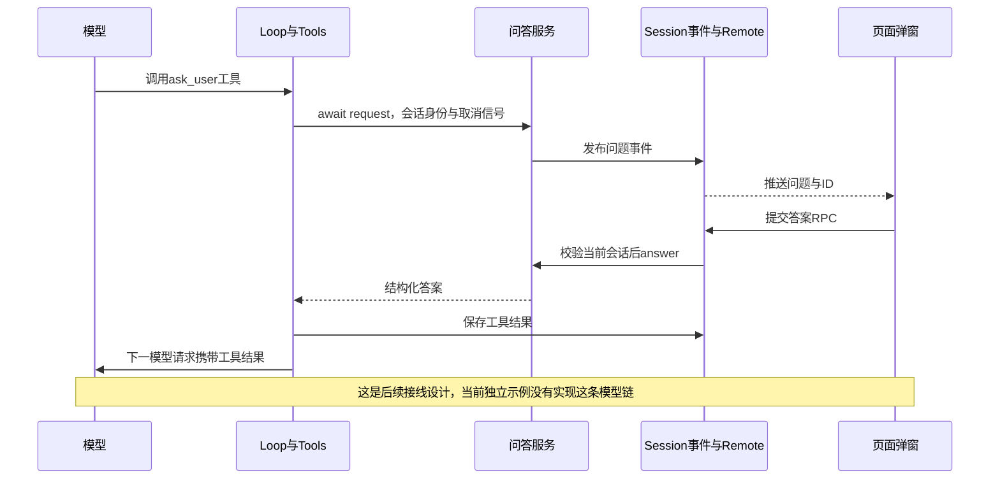
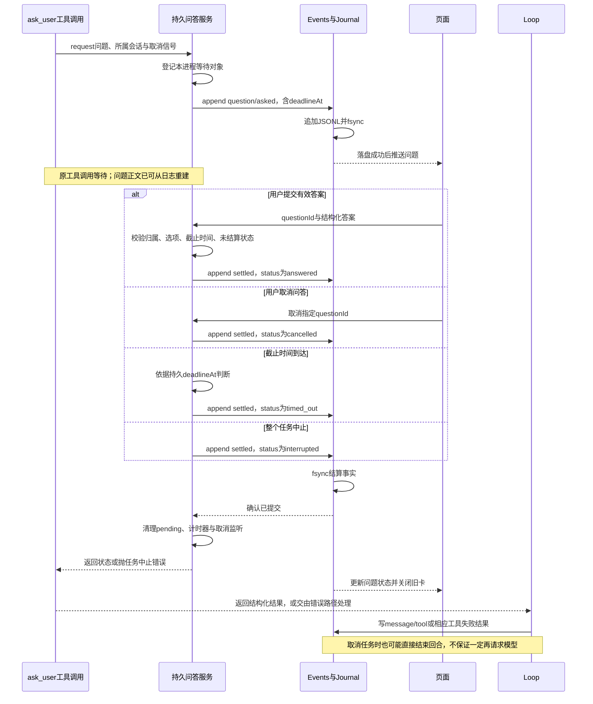
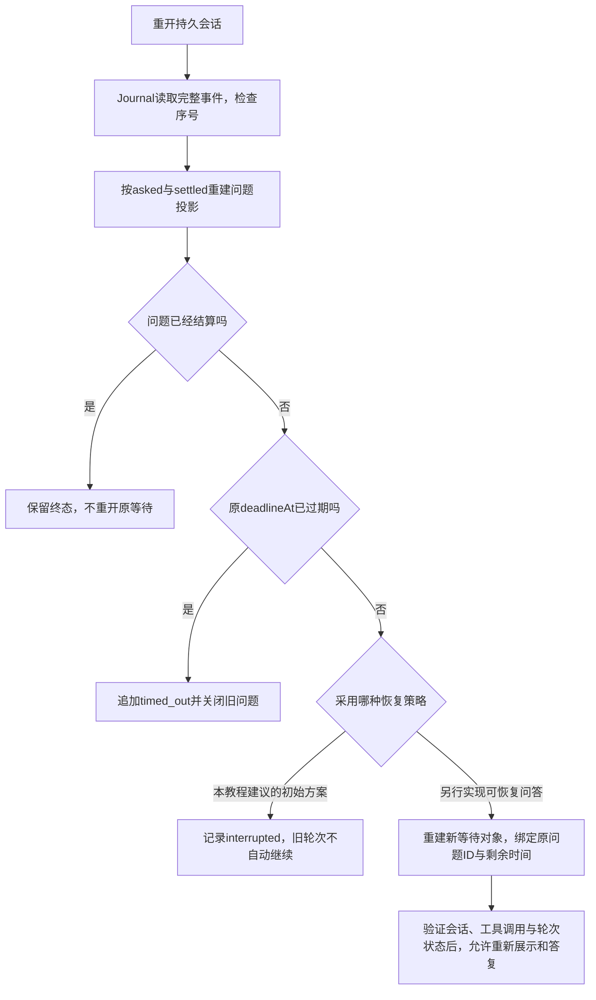
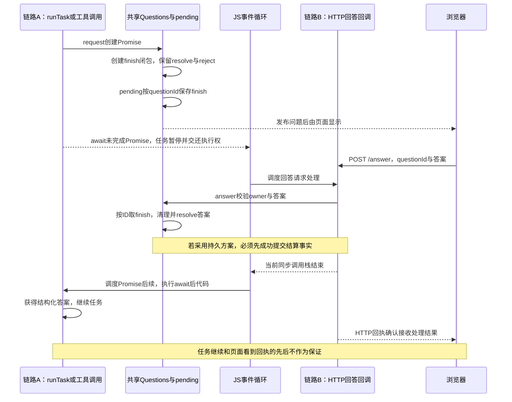

# 023补充：从单选弹窗到调用方继续执行

返回[023 · 一次审批只唤醒一次调用](../lessons/023.md)。本教程在Approvals基础上增加一个独立问答实验：用本机页面实际回答问题，观察原来停在await处的函数继续执行。示例没有调用模型、没有接真实Host，也不改变023基础测试。

## 1. 先确定需要哪种用户交互

| 类型 | 例子 | 合法答案 | 领域含义 |
| --- | --- | --- | --- |
| 操作审批 | 是否允许执行命令？ | 允许／拒绝 | 能否执行某个动作 |
| 单选问答 | 使用哪种数据库？ | 一个选项ID | 收集用户偏好或缺失信息 |
| 多选问答 | 需要哪些功能？ | 选项ID数组 | 收集多个选择 |
| 文本问答 | 项目名称是什么？ | 字符串 | 收集自由输入 |

“弹窗”是页面展示方式，不是领域类型。服务端必须知道这是单选、多选还是文本，并验证答案；不能让前端决定答案是否有效。取消问答返回cancelled，超时返回timed_out，任务中止通过AbortSignal抛错，都不能假装用户选择了某项。也不能用用户回答某选项代替执行命令的权限许可。

## 2. 先看目录和调用关系

```text
examples/023-questions/
├── questions.mjs       # Questions登记簿：等待、校验、回答、取消与超时
├── server.mjs          # Bun HTTP入口，启动演示任务
├── index.html          # 原生dialog；单选radio、多选checkbox、文本input
└── questions.test.mjs  # 生命周期测试与真实HTTP集成测试
```

完整源码：[Questions](../examples/023-questions/questions.mjs)、[本机服务](../examples/023-questions/server.mjs)、[页面](../examples/023-questions/index.html)、[测试](../examples/023-questions/questions.test.mjs)。这些是补充实验文件，已经有中文注释；没有把它们加入累计工程的Agent工具表。



## 3. 直接运行，看到真实弹窗

需要本机已有Bun，不需要安装第三方依赖。在仓库根目录执行：

```sh
bun tutorial/linear/examples/023-questions/server.mjs
```

复制终端打印的本次http://127.0.0.1:端口地址，在浏览器打开。不要直接打开静态index.html，也不要在GitHub Pages上期待这个示例启动Bun服务。

1. 点击“单选问答”，选择SQLite并提交，页面结果应为status:answered、value:sqlite。
2. 点击“多选问答”，勾选两个选项，结果value应是数组。
3. 点击“文本问答”，输入项目名称并提交，结果value是字符串。
4. 再启动一个问题，点“取消问答”或按Escape，结果为cancelled，调用方结束等待并决定后续动作。
5. 超过默认两分钟不答，结果为timed_out；需要观察快速超时，用测试中的短预算。
6. 在没有弹窗阻挡时可点击“取消整个任务”；自动测试直接验证任务AbortSignal中止。模态弹窗打开时，外层按钮不可点击，这是dialog的正常行为。
7. 终端Ctrl+C退出。服务先中止等待，再关闭监听；演示数据仅在内存，重启不会恢复问题。

原生dialog的关闭按钮或Escape必须通知服务端结算。只让弹窗消失、不取消服务端等待，会留下一个迟迟不结束的任务。

## 4. 结构化问题和答案

```javascript
// 问题结构：使用稳定ID回传，显示标签可以单独调整。
const question = {
  kind: 'single',
  title: '选择数据库',
  options: [
    { id: 'sqlite', label: 'SQLite' },
    { id: 'postgres', label: 'PostgreSQL' },
  ],
}

// 用户选择的答案，与审批boolean保持分离。
const answer = { status: 'answered', value: 'sqlite' }
```

调用方使用await等待结果。示例server.mjs的runTask执行的就是这条路径：

```javascript
// questions和signal由任务拥有者提供；这里展示接入方式。
const answer = await questions.request(owner, question, signal)

// 只有answered才是用户给出的有效信息。
if (answer.status === 'answered') {
  console.log('用户选择：', answer.value)
} else {
  console.log('没有获得答案：', answer.status)
}
```

问题ID用于回答“是哪一次问题”；owner用于回答“属于哪个会话”。演示服务固定为demo-session，不接受浏览器随意指定owner。实际产品必须通过已有认证与会话权限取得owner，不能相信请求正文里的身份。

## 5. 等待与结算时序



登记必须先于发布：如果publish回调立即答复，pending和清理函数应已经准备好。合法答复后先删除pending，再通知页面，旧页面或另一客户端的重复答复无法唤醒第二次。

## 6. 将来怎样接入真正的Agent



接到现有工程时，需要增加ask_user工具、Host拥有的Questions实例、Remote回答方法、页面状态投影与弹窗，以及问题和回答事件的持久化。模型拿到的是工具结果，不需要把答案另塞一份进系统提示词。

Questions可以参考Approvals的一次性等待方式，但不能直接调用Approvals.answer传字符串：本章allowed === true会把字符串变成false。先把两条真实功能链跑通，再考虑提炼公共等待组件，比先设计通用框架更容易理解和验证。

## 7. 验证与调试

只运行这份补充实验的测试：

```sh
bun test ./tutorial/linear/examples/023-questions/questions.test.mjs
```

| 验证范围 | 观察点 |
| --- | --- |
| 单选与归属 | 错会话、未知选项拒绝，原问题仍可正确回答 |
| 多选与文本 | 多选拒绝重复ID，文本拒绝空白，答案保持原类型 |
| 取消与超时 | cancelled、timed_out、任务Abort不同，pending最终清空 |
| 发布边界 | 同步回答不丢失，发布失败清理等待 |
| 真实HTTP | 启动任务、接收答案、runTask继续、迟答拒绝 |

在VS Code仓库根目录的终端可以这样先等待附加：

```sh
bun --inspect-brk=127.0.0.1:6510/questions-023 tutorial/linear/examples/023-questions/server.mjs
```

使用Bun附加配置连接本次终端打印的完整ws地址，继续到“打开页面”后再开浏览器。先在questions.mjs的pending.set、answer校验和finish断点；再在server.mjs的await questions.request之后设断点。浏览器选择后，服务端先结算、再命中await之后。这里只给启动命令，不覆盖现有launch.json；023基础测试配置不会运行这份独立示例。长暂停会影响两分钟超时，观察后应继续并关闭服务。

## 8. 本示例的边界

这是本机单会话、内存状态、轮询页面的教学实验；问题不是模型生成，也没有接入现有Host、Journal或工具权限守卫。刷新页面可以重新看到当前未结算问题，但重启服务不能恢复。持久问答还需要定义重启时未答问题的恢复方式和迟答处理，不能只序列化Promise。生产接入还应补齐认证、输入大小限制、并发与连接故障策略。

固定原版分别提供[user-questions](../../../deepseek-harness/packages/interaction/user-questions/README.zh.md)与[tool-ask-user](../../../deepseek-harness/packages/interaction/tool-ask-user/README.zh.md)，本实验不是其完整协议复刻。

## 9. 持久问答：问题、回答、取消和超时怎样进入eventlog

本节以下内容是接入Journal时的设计教程，不是前面内存示例已经实现的行为。事件名是教程建议，不是固定原版协议。eventlog保存事实，pending中的Promise、resolve/reject、计时器和AbortSignal只属于当前进程，不能直接JSON序列化后恢复。

### 9.1 两类问答事件，加一条工具结果

建议使用question/asked记录问题，用question/settled统一记录四类结算，避免先写answered、再写settled造成两个事件之间的空隙：

| 事件 | 关键字段 | 作用 |
| --- | --- | --- |
| question/asked | questionId、toolCallId、turnId、owner、question、deadlineAt | 保存问题全文、稳定选项ID、所属会话、关联调用与绝对截止时间 |
| question/settled，status=answered | questionId、toolCallId、owner、value | 保存经服务端校验的结构化答案 |
| question/settled，status=cancelled | questionId、toolCallId、owner、reason | 保存取消问答，无答案值 |
| question/settled，status=timed_out | questionId、toolCallId、owner | 保存超时，无答案值 |
| question/settled，status=interrupted | questionId、toolCallId、owner、reason | 保存任务中止或重启后的中断处理 |
| message/tool | role、callId、name、content | Loop把调用结果交给后续模型请求 |

“用户取消问答”和“取消整个任务”分别用cancelled与interrupted表达。按钮取消不会自动授权工具，超时也不能默认选择第一项。以前示意的question/answered是另一种命名选择；本节统一使用question/settled加status，不要求两种格式同时写。

下面展示事件的type/data部分，实际外层format、sessionId、seq和time仍由Events.append生成：

```javascript
// 示例数据结构，不是给当前内存Questions增加一个publish回调就能完成持久化。
const asked = {
  type: 'question/asked',
  data: {
    questionId: 'question_123',
    toolCallId: 'call_456',
    turnId: 'turn_789',
    owner: 'session_owner',
    deadlineAt: 1900000120000, // 绝对毫秒时间示意，不能每次重启重新加两分钟。
    question: {
      kind: 'single',
      title: '选择数据库',
      options: [
        { id: 'sqlite', label: 'SQLite' },
        { id: 'postgres', label: 'PostgreSQL' },
      ],
    },
  },
}

// 单选值是ID，多选是ID数组，文本是字符串；都先校验再保存。
const answered = {
  type: 'question/settled',
  data: {
    questionId: 'question_123', toolCallId: 'call_456',
    owner: 'session_owner', status: 'answered', value: 'sqlite',
  },
}
```

owner不是信任浏览器发来的字符串，而是接入层依据会话权限确定的身份。服务端要用已记录的question验证答案，不用客户端随答案附带的选项替换原问题。

### 9.2 顺序：先写成功事实，再让用户或调用方看到成功



这里的重点是：结算事件持久化成功后，才能确认HTTP/RPC答复成功、清除等待状态并唤醒调用者。页面重复提交、用户回答与计时器竞争，都必须在同一会话写入者中串行判定，只允许第一个合法终态提交。截止后才送达的答案不能因为计时器回调尚未运行而被接受；处理答案时也要比较deadlineAt。

对可能由发布监听器同步触发的重复回答，还要有“正在结算”保护，避免第一次append尚未返回时重入。单进程Map检查不等于多进程并发控制；本教程Journal的独占锁只是阻止两个写入者同时打开该日志，不提供分布式事务。

**不能把当前示例的publish直接换成写盘函数就宣称完成。** questions.mjs的finish先删除pending，而且会捕获结算publish异常后继续返回答案；这对内存展示容错适用，却不能保证结算落盘。持久版本需要单独的提交步骤，提交失败不得按成功继续。若写入或fsync失败导致提交状态不确定，应暂停该会话写入并重读确认，不盲目追加第二份答案。

### 9.3 message/tool与问答结算为何都需要

question/asked与question/settled用于恢复页面状态、审计和拒绝迟答；message/tool用于模型历史。它们关联同一次工具调用，但不是同一条记录：问答事件在这里命名为toolCallId，当前教程Loop的message/tool字段名实际是callId，值必须对应。不要把模型提供方协议里的tool_call_id误写成教程内部字段。

```javascript
// 回答已经持久提交后，工具返回值才可进入Loop的工具结果路径。
const result = { status: 'answered', value: 'sqlite' }

// 示意当前教程的模型消息结构；工具调用记录必须能关联同一个ID。
session.append('message/tool', {
  role: 'tool',
  callId: 'call_456',
  name: 'ask_user',
  content: result,
})
```

仅记录question/settled不会自动让模型看到答案：当前messages投影只接受message/user、message/assistant与message/tool。模型可见路径参考[031的Skill补充](../lessons/031.md)，同样要区分日志事实与请求消息。

## 10. 重启后恢复什么：先恢复状态，再决定怎样继续任务

### 10.1 从日志投影待答问题

重开会话后，先由Journal读取有效的完整事件，再按seq从前到后建立问题状态：遇到asked创建待答项；遇到settled将其改成终态。可保留已结算记录用于显示和审计，待答索引中只放尚未结算的问题。重复终态或引用不存在问题的结算应明确报告数据异常，不默默用后一条覆盖前一条。

恢复时检查原deadlineAt：已过期的未结算问题由拥有写权限的恢复流程追加timed_out事件，不能只在页面上隐藏；尚未过期才有资格按所选恢复策略继续。不要每次启动重新给完整等待时长。已回答、取消、超时和中断的问题，都不能再次作为新问题接受回答。



### 10.2 第一版建议：中断旧调用，显式重新开始

当前041 Host发现未结束回合时会记录interrupted，且不自动重放工具；因此最容易与已有实现保持一致的方案是：先处理到期问题，其余未结算问题记录interrupted，页面显示“服务重启，原问题已中断”。用户明确继续后，由新一轮创建新问题ID，旧卡答案被拒绝。

这不等于恢复原任务，但能明确告诉用户发生了什么，也不把上次已经执行的其他工具再运行一遍。要采用“保持原问题等待”的策略，需要改变Host目前的恢复行为，不能只恢复Questions.pending就宣称支持。

### 10.3 进阶方案：可恢复问答需要显式续接，不是恢复旧Promise

若产品要求重启后继续原问题，需要把等待点设计成可恢复状态机：记录关联调用、轮次与截止时间；启动时重新创建等待对象并绑定原questionId；确认该工具调用仍被允许继续；答案提交后通过明确的恢复入口交给执行器。新的Promise可以承接新建立的等待，但旧进程中的函数调用栈已经不存在。

已经落盘的答案也不保证Loop来得及记录message/tool。必须检查关联工具结果是否已经提交，并按恢复协议补交或报告中断；不能只根据pending里没有记录就重新运行整个工具。

| 崩溃发生的位置 | 日志可能有什么 | 恢复时应判断什么 |
| --- | --- | --- |
| asked落盘前 | 没有问题事实 | 不显示一张仅在内存中出现过的旧卡 |
| asked落盘后、用户未回答 | 只有asked | 检查deadlineAt，再按中断或续接策略处理 |
| settled落盘后、旧Promise未唤醒 | 已有答案或其他终态 | 终态有效，不允许用户再回答，不依赖旧resolve是否执行 |
| answered落盘后、message/tool未落盘 | 有用户答案，无模型工具结果 | 通过明确恢复逻辑处理关联调用，不重放已有副作用 |
| message/tool已经落盘 | 问答终态与工具结果都有 | 不重复写结果、不重复注入答案，按Host恢复策略继续或中断 |

本方案中asked、settled和message/tool是不同提交，不假设存在跨事件原子事务。若恢复代码可能多次运行，需要用questionId与toolCallId检查已提交事实，并限制会话写入所有权；只靠前端隐藏按钮无法实现。

### 10.4 日志文件损坏、锁文件与“刷新页面”也要区分

浏览器刷新只丢页面内存，服务未退出时原Promise仍在；服务重启才需要重建投影和决定调用恢复。本实验仍是内存版本，实际运行它重启不会保留上述记录。

持久方案还依赖[006日志恢复](../lessons/006.md)：Journal只截断末尾无完整换行的残留，不自动修复中间坏行。崩溃可能留下独占锁文件，必须核实原写入者已经退出后再处理，不能为重开问答直接删除仍在使用的锁。

### 10.5 与原版事件语义的边界

本节question/asked与question/settled是建议格式。固定原版user-questions/tool-ask-user具有自己的工具结果和持续待答机制；正常同步回答可以进入工具结果，已转为持续待答问题的后续答案可由user/message、source.kind=user-question-reply及callId关联。不要把本节事件名、超时即关闭或重启中断策略套成原版现有协议。

本次新增内容没有给内存示例实现Journal、事件回放或进程崩溃测试；上文是下一步持久化设计与应补验收场景。后续实现至少应覆盖四种结算、迟答与竞争、两次重启不延长截止时间，以及“答案已落盘而工具结果未落盘”的故障窗口。

## 11. await等待时，谁接收回答？pending与resolve怎样关联？

### 11.1 两条执行链，共用同一个Questions实例

await只暂停当前异步函数，等待尚未完成的Promise时会交还执行权。它不会把整个Bun进程、HTTP服务或JS事件循环一起暂停。因此任务可以等待，而服务继续处理页面的回答请求。

| 执行链 | 入口 | 等待与继续的位置 |
| --- | --- | --- |
| A：任务提出问题 | server.mjs的runTask | await questions.request暂停；Promise结算后继续 |
| B：用户提交回答 | HTTP的POST /answer | 调用同一个questions.answer，通过问题ID找到等待者 |

本例不是一个线程强行打断另一个线程，也不是轮询某个answered变量。页面轮询/state只是刷新显示；服务端恢复任务依靠Promise结算。两个入口必须访问同一份pending；每个HTTP请求都new Questions会导致查不到原问题。跨进程部署时也不能把resolve函数随网络发送，要把回答路由回拥有该等待对象的进程，或使用第10节明确的恢复协议。

### 11.2 questionId是钥匙，finish闭包保留resolve与reject

实际questions.mjs没有把resolve直接放进Map，而是保存一个包装它的finish：

```text
本次request创建的Promise
    ├── resolve：使等待成功结束
    └── reject：使等待以错误结束
              ↑ 被finish闭包引用
pending[questionId] = { owner, question, finish }
              ↑
answer(owner, questionId, answer)按ID找到这一项
              ↓
finish → 清理 → resolve(answer)或reject(error)
```

不同问题各有自己的Promise和闭包，不能只保存一个全局resolve，否则后来的问题会覆盖前一个等待。owner校验负责回答“谁可以答”，questionId负责回答“答哪一次问题”，选项校验负责回答“这个答案是否合法”。

下面摘取实际内存实现的关键部分，省略问题结构检查、计时器和发布异常处理；完整可运行版本仍是[questions.mjs](../examples/023-questions/questions.mjs)：

```javascript
// request内部：每调用一次，创建属于本次问题的Promise。
return new Promise((resolve, reject) => {
  // finish闭包持有本次resolve/reject，之后HTTP回调仍可通过Map间接调用。
  const finish = (answer, error) => {
    // 先删除保证重复回答不能再次进入结算；完整实现还清理计时器与取消监听。
    if (!this.pending.delete(id)) return
    if (error) reject(error)
    else resolve(answer)
  }

  // 先登记，再发布；即使publish同步触发回答，也能找到本次等待。
  this.pending.set(id, { owner, question: snapshot, finish })
  this.publish({ type: 'question/request', id, owner, question: snapshot })
})
```

回答入口的关键部分：

```javascript
// answer内部：这是HTTP回调触发的另一条执行链，不需要原任务先结束。
const pending = this.pending.get(id)
if (!pending || pending.owner !== owner) {
  throw Error('问题不存在或不属于当前会话')
}

// 完整实现还检查status、单选ID、多选数组和文本长度。
// 调用保存的finish，即调用了原request闭包里的resolve。
pending.finish({ status: 'answered', value: structuredClone(answer.value) })
```

上面是内存版的清理顺序，不是第9节持久化提交算法。持久版本需要先提交答案事实、确认成功，再结束等待；不能照搬先删除pending的顺序就声称已经可靠落盘。

### 11.3 双向响应时序



resolve不会同步跳进原任务执行栈，它使Promise结算，await后续由微任务调度执行。对于本例返回普通答案对象的resolve，当前同步调用栈先完成，任务后续才恢复。因此不需要让工具主动跳出循环，再通过特殊跳转进入answered处理。

在真实Agent中，被等待的是Loop里的某次工具执行；外部HTTP或RPC接收循环必须仍然独立接收回答。若把接收循环写成“读到提问请求后同步等整个工具执行完，才读下一条回答”，会造成双方互等。单独的Questions登记簿不能修复这个传输层阻塞，需要让消息接收继续运转。

### 11.4 JS写法中，什么才会把回答卡住？

```javascript
// 正确：Promise未完成时，当前函数等待，但服务可以继续处理请求。
const answer = await questions.request(owner, question, signal)

// 错误示意：不要在示例中运行，会持续占用JS线程。
// while (!answered) {}
```

长时间同步计算、同步阻塞或死循环都可能使HTTP回调、超时和取消处理无法及时执行。await并不把任意代码自动变成后台线程；只有执行到异步等待并交还控制后，其他回调才有机会运行。

事件与唤醒也要区分：session.append('question/settled', ...)只记录事实，除非另有明确订阅接线，否则不会自动resolve。反过来，resolve只恢复本进程的等待，不会自动把答案写入Journal。持久问答服务必须显式组织这两个动作。

### 11.5 跟着现有示例验证

1. 启动server.mjs并打开页面，在questions.mjs的pending.set处断点，观察id及本次finish。
2. 在server.mjs的await questions.request之后设断点，发起单选问题。提交答案前，这个断点不应命中；页面仍能通过/state取得待答问题。
3. 在answer的pending.get与pending.finish处断点，页面提交后确认使用的是同一个questionId和Questions对象。
4. 继续执行finish，看到pending删除，然后才命中原任务await后的代码。调试时如果整个服务被断点暂停，HTTP也会等待，需继续服务；这与普通await暂停任务不同。
5. 再次提交旧ID会被拒绝；取消、超时通过同一finish清理。已有questions.test.mjs覆盖同步回答、重复回答、取消、超时，以及HTTP回答后runTask继续。

本节没有新增第二套问答实现，也没有改动实际工具或持久化行为；它解释当前可运行示例如何关联等待与答案。服务重启后Map和闭包均消失，仍须按第10节处理，而不是从eventlog中反序列化resolve。
