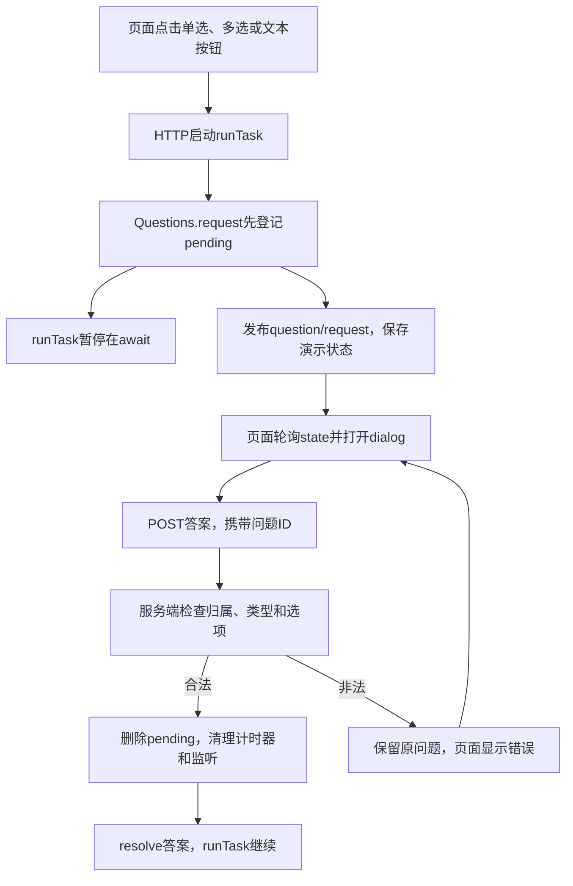
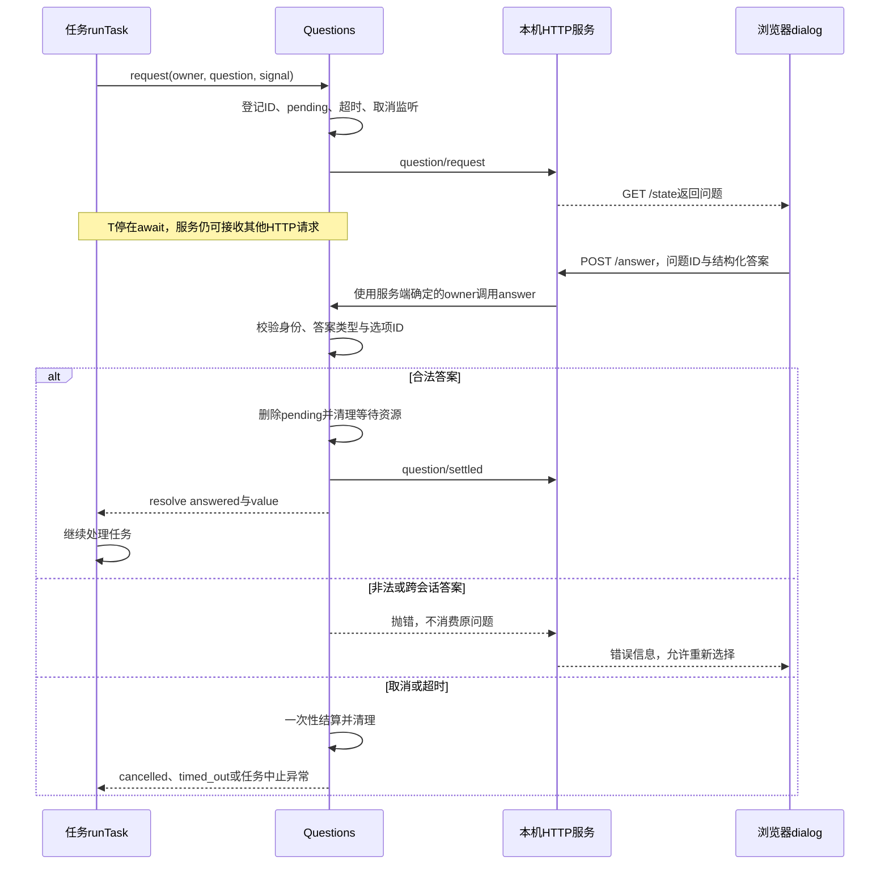
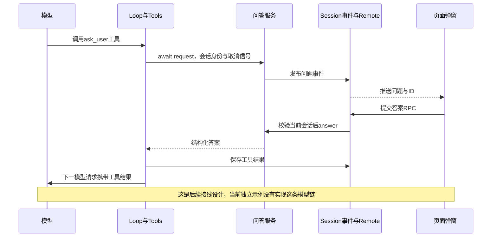

# 023补充：从单选弹窗到调用方继续执行

返回[023 · 一次审批只唤醒一次调用](../lessons/023.md)。本教程在Approvals基础上增加一个独立问答实验：用本机页面实际回答问题，观察原来停在await处的函数继续执行。示例没有调用模型、没有接真实Host，也不改变023基础测试。

## 1. 先确定需要哪种用户交互

| 类型 | 例子 | 合法答案 | 领域含义 |
| --- | --- | --- | --- |
| 操作审批 | 是否允许执行命令？ | 允许／拒绝 | 能否执行某个动作 |
| 单选问答 | 使用哪种数据库？ | 一个选项ID | 收集用户偏好或缺失信息 |
| 多选问答 | 需要哪些功能？ | 选项ID数组 | 收集多个选择 |
| 文本问答 | 项目名称是什么？ | 字符串 | 收集自由输入 |

“弹窗”是页面展示方式，不是领域类型。服务端必须知道这是单选、多选还是文本，并验证答案；不能让前端决定答案是否有效。取消问答返回cancelled，超时返回timed_out，任务中止通过AbortSignal抛错，都不能假装用户选择了某项。也不能用用户回答某选项代替执行命令的权限许可。

## 2. 先看目录和调用关系

```text
examples/023-questions/
├── questions.mjs       # Questions登记簿：等待、校验、回答、取消与超时
├── server.mjs          # Bun HTTP入口，启动演示任务
├── index.html          # 原生dialog；单选radio、多选checkbox、文本input
└── questions.test.mjs  # 生命周期测试与真实HTTP集成测试
```

完整源码：[Questions](../examples/023-questions/questions.mjs)、[本机服务](../examples/023-questions/server.mjs)、[页面](../examples/023-questions/index.html)、[测试](../examples/023-questions/questions.test.mjs)。这些是补充实验文件，已经有中文注释；没有把它们加入累计工程的Agent工具表。



## 3. 直接运行，看到真实弹窗

需要本机已有Bun，不需要安装第三方依赖。在仓库根目录执行：

```sh
bun tutorial/linear/examples/023-questions/server.mjs
```

复制终端打印的本次http://127.0.0.1:端口地址，在浏览器打开。不要直接打开静态index.html，也不要在GitHub Pages上期待这个示例启动Bun服务。

1. 点击“单选问答”，选择SQLite并提交，页面结果应为status:answered、value:sqlite。
2. 点击“多选问答”，勾选两个选项，结果value应是数组。
3. 点击“文本问答”，输入项目名称并提交，结果value是字符串。
4. 再启动一个问题，点“取消问答”或按Escape，结果为cancelled，调用方结束等待并决定后续动作。
5. 超过默认两分钟不答，结果为timed_out；需要观察快速超时，用测试中的短预算。
6. 在没有弹窗阻挡时可点击“取消整个任务”；自动测试直接验证任务AbortSignal中止。模态弹窗打开时，外层按钮不可点击，这是dialog的正常行为。
7. 终端Ctrl+C退出。服务先中止等待，再关闭监听；演示数据仅在内存，重启不会恢复问题。

原生dialog的关闭按钮或Escape必须通知服务端结算。只让弹窗消失、不取消服务端等待，会留下一个迟迟不结束的任务。

## 4. 结构化问题和答案

```javascript
// 问题结构：使用稳定ID回传，显示标签可以单独调整。
const question = {
  kind: 'single',
  title: '选择数据库',
  options: [
    { id: 'sqlite', label: 'SQLite' },
    { id: 'postgres', label: 'PostgreSQL' },
  ],
}

// 用户选择的答案，与审批boolean保持分离。
const answer = { status: 'answered', value: 'sqlite' }
```

调用方使用await等待结果。示例server.mjs的runTask执行的就是这条路径：

```javascript
// questions和signal由任务拥有者提供；这里展示接入方式。
const answer = await questions.request(owner, question, signal)

// 只有answered才是用户给出的有效信息。
if (answer.status === 'answered') {
  console.log('用户选择：', answer.value)
} else {
  console.log('没有获得答案：', answer.status)
}
```

问题ID用于回答“是哪一次问题”；owner用于回答“属于哪个会话”。演示服务固定为demo-session，不接受浏览器随意指定owner。实际产品必须通过已有认证与会话权限取得owner，不能相信请求正文里的身份。

## 5. 等待与结算时序



登记必须先于发布：如果publish回调立即答复，pending和清理函数应已经准备好。合法答复后先删除pending，再通知页面，旧页面或另一客户端的重复答复无法唤醒第二次。

## 6. 将来怎样接入真正的Agent



接到现有工程时，需要增加ask_user工具、Host拥有的Questions实例、Remote回答方法、页面状态投影与弹窗，以及问题和回答事件的持久化。模型拿到的是工具结果，不需要把答案另塞一份进系统提示词。

Questions可以参考Approvals的一次性等待方式，但不能直接调用Approvals.answer传字符串：本章allowed === true会把字符串变成false。先把两条真实功能链跑通，再考虑提炼公共等待组件，比先设计通用框架更容易理解和验证。

## 7. 验证与调试

只运行这份补充实验的测试：

```sh
bun test ./tutorial/linear/examples/023-questions/questions.test.mjs
```

| 验证范围 | 观察点 |
| --- | --- |
| 单选与归属 | 错会话、未知选项拒绝，原问题仍可正确回答 |
| 多选与文本 | 多选拒绝重复ID，文本拒绝空白，答案保持原类型 |
| 取消与超时 | cancelled、timed_out、任务Abort不同，pending最终清空 |
| 发布边界 | 同步回答不丢失，发布失败清理等待 |
| 真实HTTP | 启动任务、接收答案、runTask继续、迟答拒绝 |

在VS Code仓库根目录的终端可以这样先等待附加：

```sh
bun --inspect-brk=127.0.0.1:6510/questions-023 tutorial/linear/examples/023-questions/server.mjs
```

使用Bun附加配置连接本次终端打印的完整ws地址，继续到“打开页面”后再开浏览器。先在questions.mjs的pending.set、answer校验和finish断点；再在server.mjs的await questions.request之后设断点。浏览器选择后，服务端先结算、再命中await之后。这里只给启动命令，不覆盖现有launch.json；023基础测试配置不会运行这份独立示例。长暂停会影响两分钟超时，观察后应继续并关闭服务。

## 8. 本示例的边界

这是本机单会话、内存状态、轮询页面的教学实验；问题不是模型生成，也没有接入现有Host、Journal或工具权限守卫。刷新页面可以重新看到当前未结算问题，但重启服务不能恢复。持久问答还需要定义重启时未答问题的恢复方式和迟答处理，不能只序列化Promise。生产接入还应补齐认证、输入大小限制、并发与连接故障策略。

固定原版分别提供[user-questions](../../../deepseek-harness/packages/interaction/user-questions/README.zh.md)与[tool-ask-user](../../../deepseek-harness/packages/interaction/tool-ask-user/README.zh.md)，本实验不是其完整协议复刻。
