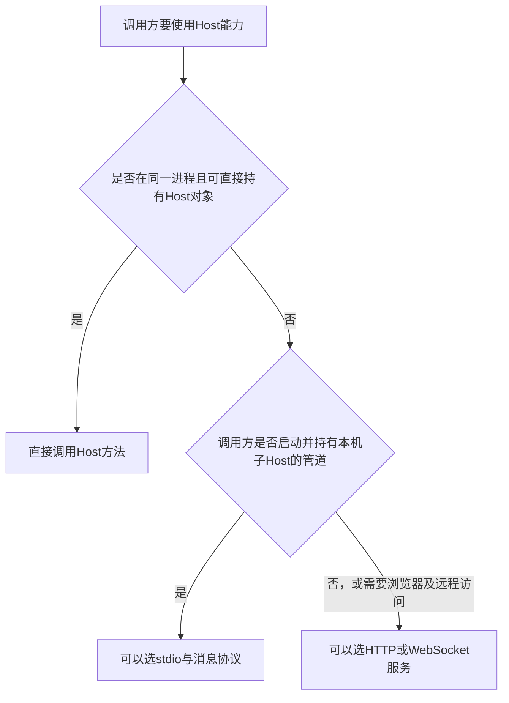
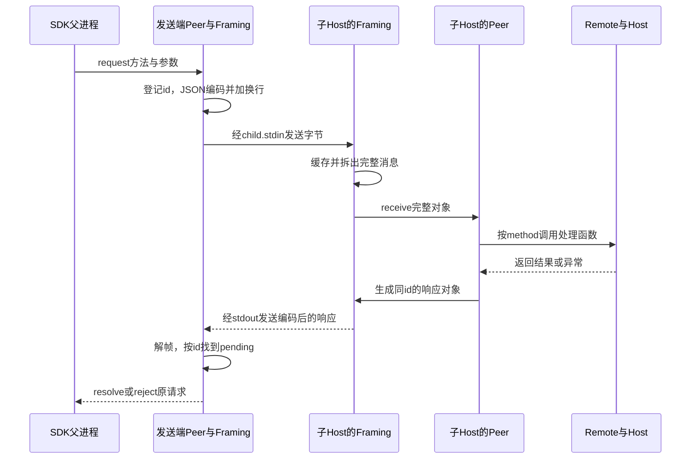
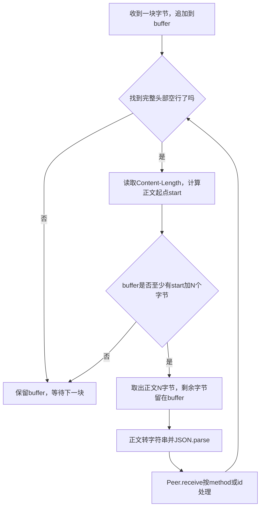
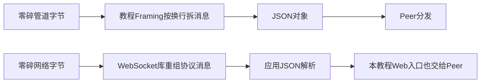
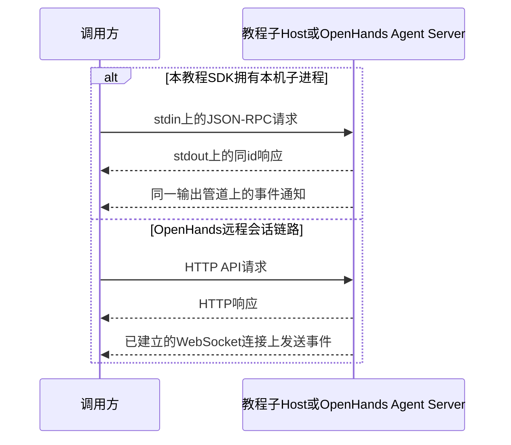

# stdio、HTTP 与 WebSocket：Host 通信方式为什么不同

适用章节：[035 · LSP](../lessons/035.md)、[044 · Bun SDK](../lessons/044.md)、[045 · Python SDK](../lessons/045.md)、[046 · ACP](../lessons/046.md)、[047 · HTTP/WebSocket](../lessons/047.md)。这是一份按背景、权衡、场景、组成、原理、对比展开的补充知识，先看一遍总图，再回到对应章节断点观察。

**核心结论：先确定调用双方的进程和部署边界，再选传输。** SDK启动本机子Host，适合复用stdin/stdout；浏览器或远程客户端连接独立服务，适合HTTP/WebSocket；同一进程内已经拿到Host对象，通常直接调用方法。这不是模型品牌规定的选择。

资料核对日期：2026-11-03。教程与固定原版的结论以本仓库代码为依据；OpenHands部分以当日官方文档和源码为依据，其main分支后续可能变化。本文没有重新部署或运行OpenHands，不宣称覆盖它所有子系统。

## 1. 背景与目的：到底要解决哪个问题

比如同样是“创建会话”，可能来自三个地方：

| 调用场景 | 调用方与Host在哪里 | 需要解决的边界 |
| --- | --- | --- |
| 测试直接调用host.create | 同一个进程，已有对象引用 | 函数参数、返回值与异常 |
| Bun/Python SDK启动Host | 不同进程，调用方掌握子进程管道 | 消息编码、分帧、响应关联、进程清理 |
| Web页面或远程客户端访问Host | 浏览器、容器或其他机器 | 服务发现、网络连接、认证、事件推送 |



图中箭头是选型判断顺序，不是依赖方向。最后一行只是常见方案：本机子进程也能开HTTP，远程访问也能用其他协议；重点是需求是否值得引入相应设施。

### 三个层次不要混淆

- **业务语义**：创建会话、提交任务、取消、订阅事件。
- **消息协议**：JSON-RPC的method/id/result，或HTTP API的路径、方法与响应结构。
- **传输与消息边界**：stdio字节流、NDJSON换行、WebSocket消息，以及HTTP协议解析。

JSON-RPC自身不规定只能使用管道，也可通过其他传输。[JSON-RPC 2.0官方规范](https://www.jsonrpc.org/specification)

## 2. 优势、劣势与权衡

| 方面 | 同进程方法调用 | stdio加NDJSON | HTTP加WebSocket |
| --- | --- | --- | --- |
| 启动 | 创建或获得对象 | 启动子进程并取得管道 | 启动或连接监听服务，等待就绪 |
| 定位对端 | 对象引用 | 父进程保存的child句柄 | 服务URL、端口或代理路由 |
| 端口 | 不需要 | 业务通信不需要；Inspector仍可能用端口 | 需要服务端口或代理入口 |
| 消息边界 | 函数调用天然有参数边界 | 自行约定换行或长度前缀 | HTTP/WebSocket库按协议处理 |
| 请求与响应 | 返回值或Promise | Peer按id关联 | HTTP请求对应响应；WebSocket仍需应用层关联规则 |
| 推送与反向请求 | 回调或事件订阅 | 双向Peer可发送通知和请求 | WebSocket可双向通信，语义仍要定义 |
| 生命周期 | 管理对象、任务与资源 | 处理EOF、断线、子进程退出 | 管理服务、连接、重连与会话归属 |
| 身份 | 不能因同进程就省略业务权限检查 | 管道不是自动的用户鉴权系统 | 需要定义网络认证与授权 |
| 代价 | 共享故障域，难以独立部署 | 自己处理分帧、背压、错误和清理 | 多了服务就绪、端口、网络及认证配置 |

这些是工程权衡，不是性能测试结果，也不是原作者动机的引文。把一个stdio请求换成HTTP，并不会自动得到更强的授权、持久化或取消语义。

**为什么教程SDK选stdio？** 从[044 SDK](../../../harness-own/src/sdk.mjs)的spawn与管道接线可以观察到：调用方本来就创建Host子进程，stdin/stdout也已经可用。使用它们可省去业务监听端口与URL发现。代价是必须把消息边界和子进程生命周期处理好。这是根据代码作出的解释，不宣称是原作者明确写下的设计理由。

## 3. 使用场景：从具体任务来选

### 场景A：Python脚本批量处理本机项目

Python脚本启动一个Bun Host，向其创建会话、提交任务并收集事件。脚本持有Popen对象，所以可直接利用stdin/stdout。第045节的读取线程按行解析，按请求id唤醒等待者；不需要额外启动HTTP服务。

### 场景B：编辑器启动一个ACP Agent

支持ACP的客户端启动Agent程序，通过协议交换初始化、任务、更新、取消与权限请求。第046节使用ACP SDK的ndJsonStream处理流。SDK隐藏了部分分帧实现，但协议仍通过字节流传输，并非直接调用另一个进程中的对象。

### 场景C：网页聊天面板控制Host

浏览器不能直接持有Bun的child.stdin。第047节先提供HTTP认证和资源服务，再升级为WebSocket，让网页发RPC消息并接收事件。服务内部仍可直接调用Host；不必每调用一次host.create再发一轮HTTP。

### 场景D：多个客户端使用远程或容器中的Agent服务

客户端只能拿到服务地址，可能根本不在Host所在机器上。HTTP/WebSocket更容易接入浏览器、代理和服务管理。这类需求与“一个脚本拥有一个子进程”不同，不应该只凭两份代码都叫SDK就要求相同传输。

## 4. 组成部分与关键点：每一层是谁

| 组件 | 本教程中的职责 | 不负责什么 |
| --- | --- | --- |
| spawn / Popen | 创建子进程、提供输入输出管道 | 不认识session.create，也不按JSON分消息 |
| Framing | 缓存字节、找边界、解析或编码消息 | 不决定请求该调用哪个Host方法 |
| Peer | 按method分发、按id匹配响应、管理等待与超时 | 不处理本章的磁盘会话业务 |
| Remote | 把会话RPC方法映射到Host调用 | 不等于HTTP客户端，也不决定传输 |
| Host / Agent | 会话管理、输入处理与任务执行 | 不应为了换传输而重写模型循环 |
| HTTP/WebSocket库 | 解析网络协议并交付请求或消息 | 不自动实现业务权限、重放或任务取消 |



箭头表示运行时调用、传输或返回。图中把同一进程内的Peer与Framing拆成观察位置，不表示它们各自是操作系统进程。项目的framing会设置peer.send，因此发送侧看起来是调用Peer，实际编码动作由Framing接管。[Peer与Framing源码](../../../harness-own/src/rpc.mjs)

### local、remote与模型API不是一回事

在remote(peer, host, 'local')中，local是调用者身份principal，创建会话时用于owner；它不是“使用本地传输”的开关。Remote注册的处理函数收到请求后，直接调用同进程的Host对象。

DeepSeek模型API请求是另一个边界。SDK到Host使用stdio，不意味着Host到外部模型也使用stdio。本文比较的是应用与Host的通信，不是模型厂商的推理接口。

## 5. 底层原理：同一条消息在四个位置的形状

### 5.1 Peer发出前与Framing发出后

假设Peer生成的请求id是req-1（实际代码使用随机UUID），交给发送函数的对象为：

```javascript
// Peer处理的是完整消息对象；方法名决定业务，id用于关联响应。
const message = {
  jsonrpc: '2.0',
  id: 'req-1',
  method: 'session.list',
  params: {},
}

// NDJSON模式的Framing将对象编码为字节，并补一个真实换行。
const bytes = Buffer.from(JSON.stringify(message))
const packet = Buffer.concat([bytes, Buffer.from('\n')])
```

管道中的可读表示如下，末尾的\n表示真实换行字节：

```text
{"jsonrpc":"2.0","id":"req-1","method":"session.list","params":{}}\n
```

### 5.2 Framing收到后与Peer收到前

一次write不保证对应一次data回调。它们之间是字节流，接收方可能先读到一部分，也可能把多条消息一起读到；发送方一次write成功也不等于对端已执行。[Node.js流与缓冲文档](https://nodejs.org/api/stream.html#buffering)

| 收到的情况 | Framing的buffer | 下一步 |
| --- | --- | --- |
| 一次收全，含换行 | 一条完整JSON和换行 | 取出JSON，解析，交给Peer一次 |
| 第一次只有前半条，没有换行 | 保留前半条字节 | 不解析，不调用Peer，等下一块 |
| 第二次补齐后半条和换行 | 拼接成完整一条 | 解析后交给Peer一次 |
| 一次收到两条，各有换行 | buffer中包含两条 | 循环拆出两条，交给Peer两次 |
| JSON文字看似完整，但没有换行 | 仍保留整段 | 本实现继续等边界，不猜测JSON结束位置 |
| 遇到完整分隔行但JSON无效 | 已确认边界，解析失败 | 本教程实现关闭连接，不把坏对象交给业务 |

```text
第一次输入：{"jsonrpc":"2.0","id":"req-1","method":"sess
buffer：保留这些字节，没有换行，不调用Peer

第二次输入：ion.list","params":{}}\n
buffer：前半条 + 后半条，找到换行
    → JSON.parse
    → Peer.receive({ jsonrpc: '2.0', id: 'req-1', method: 'session.list', params: {} })
```

缓存的是Buffer字节，在消息完整后才统一转字符串，可以应对UTF-8字符本身跨块的情况。NDJSON只能把消息分隔换行放在一行末尾，JSON字符串内容中的换行应由JSON.stringify转义；不能把美化后的多行JSON直接当作一条NDJSON请求。

### 5.3 可运行的小实验：一次收全、分两次、一次两条

在自己的PROJECT中新建临时demo文件运行，沿用项目已有rpc.mjs。它只使用内存流，不启动Host或外部模型。

```javascript
import { PassThrough } from 'node:stream'
import { setImmediate } from 'node:timers/promises'
import { Peer, framing } from './src/rpc.mjs'

// 每个实验独立创建管道，确保上一个实验的缓存不影响下一个。
async function demonstrate(label, chunks, mode = 'ndjson') {
  const input = new PassThrough(), output = new PassThrough()
  const peer = framing(new Peer(), input, output, mode)
  let calls = 0
  console.log('\n实验：', label)
  // 这里是Peer注册的业务处理函数，收到完整请求才执行。
  peer.handle('session.list', () => { calls++; return ['session-demo'] })
  output.on('data', chunk => console.log('响应：', chunk.toString().trim()))
  for (const chunk of chunks) {
    console.log('输入：', JSON.stringify(chunk))
    input.write(Buffer.from(chunk))
    // 让当前消息的异步处理完成，再观察执行次数。
    await setImmediate()
    console.log('处理函数累计执行次数：', calls)
  }
  input.end()
  output.destroy()
}

// 用不同id表示不同请求，便于观察一块字节中两条消息的响应关联。
const first = JSON.stringify({ jsonrpc: '2.0', id: 'req-1', method: 'session.list', params: {} }) + '\n'
const second = JSON.stringify({ jsonrpc: '2.0', id: 'req-2', method: 'session.list', params: {} }) + '\n'
const cut = first.indexOf('session.list') + 4
await demonstrate('一次收全', [first])
await demonstrate('分两次收到', [first.slice(0, cut), first.slice(cut)])
await demonstrate('一次收到两条', [first + second])
```

预期累计次数依次是：第一组1；第二组先0再1；第三组2。分两次收到并不会执行两次业务。

### 5.4 LSP模式：先读Content-Length，再收够正文字节

LSP是Language Server Protocol，即语言服务器协议，用于编辑器和语言服务之间的初始化、文档同步、补全和定义查询等。这里的framing(..., 'lsp')只选择它的**基础分帧格式**，不自动实现补全或语言分析能力。业务方法由Peer.handle注册，第035节fixture返回的是固定测试结果。[LSP官方说明](https://microsoft.github.io/language-server-protocol/)、[基础协议规范](https://microsoft.github.io/language-server-protocol/specifications/lsp/3.17/specification/#baseProtocol)

#### 发出去的内容长什么样

```text
Content-Length: N\r\n
\r\n
JSON正文，正好N个UTF-8字节
```

上面是转义展示：实际头部形如`Content-Length: N\r\n\r\n`，然后立即跟正文。N是占位符，发送时替换成实际数字。两个CRLF构成头部结束标记，正文末尾不需要再追加换行。这个头部类似HTTP，但整段内容仍可经stdin/stdout发送，并不是发起了一次HTTP请求。

| 组成 | 谁生成 | 接收时怎么用 |
| --- | --- | --- |
| Content-Length字段 | Framing对JSON编码后的Buffer取bytes.length | 确定正文应收多少字节，不含头部 |
| 头部与正文之间的空行 | Framing追加CRLF CRLF | 找到正文起点start |
| JSON正文 | Peer给出的消息对象经过JSON.stringify与UTF-8编码 | 收够长度后一次解析，再交给Peer |
| 消息后的剩余字节 | 可能是下一帧或下一帧的一部分 | 保留buffer，循环继续拆帧 |

中文“中”在UTF-8中占3个字节，而JavaScript中的“中”.length是1，不能用JSON字符串的length填写Content-Length。本教程发送端先Buffer.from，再取bytes.length。换成LSP模式以后，Peer管理method、id、pending的逻辑不变。[本教程分帧代码](../../../harness-own/src/rpc.mjs)

#### 收到头部一半、正文一半时怎么处理

| 本轮输入 | Framing保存的状态 | 是否调用Peer |
| --- | --- | --- |
| 第一次只到Content-Len | 没找到完整空行，保留buffer | 否 |
| 第二次补齐头部，但正文不足N字节 | 已算出start与N，继续等待 | 否 |
| 第三次补齐正文 | 截取N个字节，保留剩余buffer | 是，完整对象仅分发一次 |
| 一次收到两帧 | 拆完第一帧，继续检查剩余头部与正文 | 两次，各对应一条消息 |



具体对应源码的几个变量：

```javascript
// 找不到头部结束空行，说明连长度信息都还没有完整收到。
const header = buffer.indexOf('\r\n\r\n')
if (header < 0) break

// 本教程读取Content-Length，并检查正文字节是否已经收齐。
const match = /^Content-Length: (\d+)$/im.exec(buffer.subarray(0, header).toString())
// 源码在这里另有!match检查；缺少有效长度会关闭Peer。
const size = Number(match[1])
const start = header + 4
if (buffer.length < start + size) break

// 不把剩余半条消息扔掉；它可能在下一轮data中才补齐。
const raw = buffer.subarray(start, start + size)
buffer = buffer.subarray(start + size)
// 仅完整正文才进入Peer；源码还会处理JSON解析与receive失败。
peer.receive(JSON.parse(raw.toString()))
```

这是源码阅读摘录，break依赖外层拆帧循环，不能脱离循环作为独立脚本执行。找到长度、收够正文、剩余字节继续处理三个动作缺一不可。异常长度和坏JSON也不能当作业务参数正常分发。

#### 继续做实验：把同一套Peer切成LSP分帧

前面5.3的小实验已经把mode参数传给framing。在**同一份demo文件尾部**追加以下代码，沿用demonstrate函数：

```javascript
// 使用中文正文验证字节计数，并故意在“中”的UTF-8字节中间切开。
const lspBody = Buffer.from(JSON.stringify({
  jsonrpc: '2.0', id: 'lsp-1', method: 'session.list', params: { note: '中文' },
}))
const lspHeader = Buffer.from('Content-Length: ' + lspBody.length + '\r\n\r\n')
const lspPacket = Buffer.concat([lspHeader, lspBody])
const utf8Cut = lspPacket.indexOf(Buffer.from('中')) + 1

// 一帧完整输入，处理一次。
await demonstrate('LSP一次收全', [lspPacket], 'lsp')
// 第一块头部不全，第二块正文不全，第三块才补齐：累计0、0、1次。
await demonstrate('LSP头部与正文分块', [
  lspPacket.subarray(0, 8),
  lspPacket.subarray(8, utf8Cut),
  lspPacket.subarray(utf8Cut),
], 'lsp')
```

这里仍然只注册了session.list示例方法，目的是观察分帧，并非完整语言服务器。UTF-8被切开时，Framing保留Buffer并在正文收齐后统一解码，所以处理函数最终收到的params.note仍应是完整“中文”。

#### 与NDJSON相比，究竟换了什么

| 对比 | NDJSON模式 | 本教程的LSP分帧模式 |
| --- | --- | --- |
| 消息边界 | 每条JSON末尾的LF | 头部空行与Content-Length |
| 正文格式 | 一条消息用单行JSON | 按长度收取，正文可以包含格式化空白 |
| 遇到半条消息 | 等换行 | 等完整头部，再等足量正文 |
| 输入中出现中文 | 完整消息后再解码 | 同样先按字节收齐，长度必须正确 |
| Peer业务分发 | method、id与pending | 完全复用，不因分帧切换而自动增加业务 |

当前代码是教学版长度解析器，不是完整的LSP协议校验器。它有总buffer大小限制，但不应据此宣称已经验证所有非法头部、重复长度、超大声明长度及协议生命周期。更完整的语言服务还需要initialize、能力协商、文档版本、查询语义和shutdown等实现；回到[第035节](../lessons/035.md)查看具体接线与证据范围。

### 5.5 WebSocket为什么不用找换行

WebSocket协议本身有帧和消息规则。库会把底层零碎字节及分片整理成消息，再触发应用的message回调；不代表底层网络不会分片。[RFC 6455：数据分片](https://www.rfc-editor.org/rfc/rfc6455.html#section-5.4)



本教程[HTTP/WebSocket接线](../../../harness-own/src/http.mjs)直接把WebSocket的message解析为对象，再交给Peer.receive；没有再经过stdio的framing。HTTP普通接口则由HTTP库和框架处理请求边界，应用仍需收齐或按协议流式处理正文，不能假定每次收到的正文块都是完整JSON。

### 5.6 超时、取消、背压与退出不能混为一谈

| 情况 | 真实含义 | 本教程需要观察什么 |
| --- | --- | --- |
| request超时 | 本次等待结束 | Peer移除pending，不代表Agent已取消 |
| session.cancel | 业务取消请求 | Agent中止当前活动，仍要观察结束事件 |
| write返回false | 对普通未报错Writable表示触及缓冲阈值，应暂停后续写入 | 当前chunk不应因此重发；正常应等待drain或使用支持背压的管道 |
| stdin结束 / EOF | 没有后续输入 | sdk-server的closed处理会尝试关闭Host，不等于所有程序天然随EOF退出 |
| 进程崩溃或强制终止 | 连接与活动可能中断 | 不能只靠传输推断工具是否已产生副作用 |

当前framing在写入返回false且缓冲超过阈值时抛错，并未实现完整的排队与drain等待。因此它是教学实现，不能说已经具有成熟流库的全部背压处理。[Node.js write与drain](https://nodejs.org/api/stream.html#event-drain)

## 6. 与已有实现对比：教程、固定原版与OpenHands

### 6.1 先把证据范围摆清楚

| 被比较的实现 | 可确认事实 | 不能据此推断 |
| --- | --- | --- |
| 本教程044 SDK | Bun父进程spawn子Host，framing与Peer走stdio | 不能代表原版所有SDK实现 |
| 本教程045 Python SDK | Popen、读取线程、按行JSON与id关联 | Python与Bun不是同一个调试进程 |
| 本教程046 ACP | ACP SDK的ndJsonStream接子进程管道 | 不能说它调用了本教程的自写framing |
| 本教程047 Web | HTTP认证与资源，WebSocket消息进入Peer | 本地网络入口没有因此变成可公网部署的完整产品 |
| 固定DeepSeek Harness原版ACP | 生产默认JSON-RPC stdio；源码也允许测试注入stream | 不能扩大为“原版所有入口都使用stdio” |
| OpenHands远程会话 | RemoteConversation通过HTTP与WebSocket连接Agent Server | 不能扩大为“整个OpenHands不使用任何其他传输” |
| OpenHands本地SDK | 官方架构另有同进程本地运行模式 | 不应给同进程调用强加一个网络层 |

原版ACP依据：[固定版本入口源码](../../../deepseek-harness/packages/acp/acp/src/index.ts)。其默认流使用ndJsonStream，运行时transport override供测试注入。与本教程自写Peer的结构不能直接画等号。

OpenHands依据：[官方架构](https://github.com/OpenHands/docs/blob/main/sdk/arch/overview.mdx)、[RemoteConversation源码](https://github.com/OpenHands/software-agent-sdk/blob/main/openhands-sdk/openhands/sdk/conversation/impl/remote_conversation.py)。前者说明本地与服务端部署的区别；后者可以核对httpx请求与WebSocketCallbackClient。本文只比较这条远程会话链路。

### 6.2 相同需求，不同通信组织



图比较的是应用可见的通信组织，不表示两边API名称相同，也不表示HTTP响应一定等到整个模型回合结束。

基于部署方式作出的工程判断是：当调用方拥有本机子进程时，stdio自然可用；当服务运行在容器或其他机器并由多个客户端访问时，URL与网络协议更便于连接。两者的分帧工作都存在，只是教程把一部分写成了Framing，而网络库提供了HTTP/WebSocket协议处理。

## 举一反三：换一个约束，答案还成立吗

### 联想：还可以怎样做

本机进程也可以通过Unix domain socket或本地HTTP通信；单向事件可考虑SSE；标准ACP接入可复用SDK流适配。选型时要明确消息边界、身份、取消和生命周期，不能只换掉一个send函数就宣称全部能力等价。

### 抽象：把“调用一次”分成六个问题

```text
谁创建执行方 → 怎样找到它 → 怎样编码和分帧
    → 怎样关联请求与响应 → 怎样验证身份与权限 → 怎样取消和收尾
```

同进程、stdio、HTTP、WebSocket分别回答这些问题，并不改变“Host管理会话、Agent执行任务”的业务职责。

### 自省：几个容易推翻直觉的反例

1. **Host挪到另一台机器，child.stdin还能直接用吗？** 不能把原来的本机句柄直接变成远程句柄，需要网络或显式转发方案。
2. **换成WebSocket就不用Peer了吗？** 消息边界由库处理，但method分发与应用层响应关联仍需实现；本教程就复用了Peer。
3. **stdio没有监听端口，所以自动安全？** 仍有不可信调用输入、工作区权限与凭据继承问题；管道不替代业务授权。
4. **Peer超时了，Agent就停止了吗？** 不是。本教程需要显式session.cancel，不能只取消等待。
5. **打印一条调试日志到stdout有什么关系？** NDJSON解析器可能把它当作协议行，解析失败并关闭连接；诊断应写stderr。
6. **HTTP与WebSocket是不是绝对不能承载JSON-RPC？** 可以承载。消息协议与传输选择是两个维度。
7. **同一条消息分两次收到，是不是要重发请求？** 不需要；接收端缓存字节，完整后仅分发一次，盲目重发反而可能重复执行。

## 总结归纳：回到代码时按什么顺序看

先看spawn/Popen或服务URL，确认部署边界；再看Framing/ndJsonStream/WebSocket回调，确认消息边界；随后看Peer或API路由，确认分发与响应关联；最后看Remote到Host的映射，以及错误、取消和清理路径。

建议先到[035](../lessons/035.md)观察Content-Length分帧，再回到[044](../lessons/044.md)观察SDK父子进程，去[045](../lessons/045.md)观察Python读取线程，去[046](../lessons/046.md)区分ACP SDK与自写Framing，去[047](../lessons/047.md)观察WebSocket复用Peer。本文是原理与代码阅读补充，不改变各章的功能完成范围，也不代表已执行OpenHands或真实模型联调。
